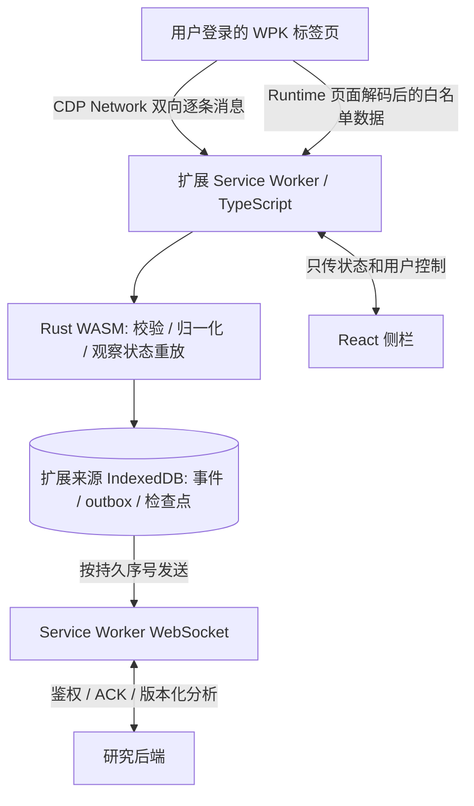

# 初版总体架构

0.3 进展：网络和业务适配、WASM 归约、IDB 原子检查点、双流通信均已实现，参见 [业务说明](wpk-business.md)。下方保留初始目标设计，具体实现和未覆盖项以当前运行文档为准。

0.2 进展：网络采集、WASM 校验、持久队列、后端通信和侧栏已经实现；页面业务适配尚未实现。实际运行和网络事件契约见 [runtime.md](runtime.md)。下文保留完整目标架构。

状态：完整目标设计；本版网络采集链路已实现，业务链路尚未实现。目标是 Chrome / Edge MV3 扩展，不需要启动浏览器远程调试端口，不依赖 DevTools 窗口常开。

## 决策与数据流

采用一个 service worker 拥有采集、WASM 实例、IDB 和研究连接。侧栏关闭不停止采集。初版只允许一个人工选择的 WPK 标签页；多桌不是本版需求。CPU 任务按消息大小和耗时设上限；首版不加入 offscreen document、共享内存、WASM 线程或额外常驻页面。

## 逐条网络采集

1. 用户在侧栏选择目标标签页并点击开始，严格校验 HTTPS、主机 `h5.wpk.com`、目标 tabId；默认不自动刷新正在进行的牌桌。
2. `chrome.debugger.attach({tabId}, ...)` 后启用 `Network`、必要的 `Runtime` 和 `Target`。监听收发、创建、关闭、错误事件。不能使用 `webRequest` 替代消息事件。
3. 处理 `Target.setAutoAttach` 和 `attachedToTarget`，在允许的关联 Worker / 跨进程 iframe 的子 session 中启用 Network。递归处理后续目标；同进程 iframe 通过 executionContext 跟踪。测试是否遗漏独立 Worker。
4. 连接标识包含浏览器会话、tabId、target/sessionId、requestId 和连接代次。不能把 requestId 当成跨目标全局 ID。`webSocketCreated` 只记录规范化端点，去掉 URL 查询、fragment 和认证信息。
5. `Network.webSocketFrameReceived` / `Sent` 得到 opcode、方向、时间与 payloadData。文本按 UTF-8，二进制按 CDP 规定从 base64 还原。CDP 的 WebSocketFrame 表示完整消息，不能再次按 TCP 包拼接。
6. 网络端点按已验证的游戏/大厅白名单过滤，不能泛抓其他标签页和所有域名。初版目标页 URL 权限不等于 debugger 的权限范围，仍须运行时约束。
7. 监听 detach、导航、context 销毁、Worker 退出、tab 关闭及错误。断开后标记覆盖缺口；用户主动停止或取消 debugger 后，不自动重新附着。

附着之前的历史不保证可取；已存在连接可能没有 Created 事件，应标记端点未知，等待可验证映射或下一次连接。采集网络消息不保证一个网络消息对应一个业务事件，心跳、批量消息及多个通知须分别编号。

## 页面业务入口

通过 CDP Runtime 在正确的 MAIN 执行上下文安装最小、只读、带版本的页面适配器。它只读取客户端已经合法解码且当前账号可见的信息，发送白名单 DTO。使用定向 Runtime binding 接收，不开放通用远程执行、任意后端地址、令牌或任意 IPC 方法。绑定输入仍是不可信数据，宿主和 WASM 均执行限长及 schema 校验。

Cocos/WPK 私有入口仅存在于 adapters/wpk，不能进入通用 reducer。适配器失效时网络消息仍可计数，但业务状态必须标记 unsupported/stale；不能悄悄改成 DOM 轮询并声称字段已验证。页面保留原方法调用次数、参数、返回值和异常行为，采集异常不能影响游戏原逻辑。

## 持久化与生命周期

Chrome 的 service worker 会停止，WASM 内存也随之丢失。所有恢复所需信息写入扩展来源的 IndexedDB；不要把页面 localStorage、侧栏组件状态、JS 全局变量或 WASM 内存当作持久化。

- 顶层同步注册 debugger、runtime、alarm 等监听，再异步恢复 IDB 和 WASM。恢复期间以串行任务链处理事件，设有界缓冲；超限停止并记录缺口。
- Chrome 125 是草案最低版本，以使用 debugger flat sessions；118+ 活跃 debugger 会话、116+ WebSocket 活动有生命周期改进，但均不能代替落盘恢复。
- 后端连接成功后每 20 秒应用层 ping/pong，失败后指数退避和抖动，最长 60 秒；alarm 用于 worker 重启后的重试，不能伪装成永不终止。
- service worker 恢复时先重建状态与 outbox，再核对现有 debugger 会话；不得无条件重复 attach。无法证明连续覆盖时创建 gap 和新 capture epoch。
- 浏览器完全退出期间不能采集；重启只能恢复已落盘记录和待确认发送。用户停止后仍可补传已落盘事件，UI 分开显示采集和发送状态。

## 界面信息

侧栏呈现：目标标签页、采集/后端状态、WASM 初始化状态、已落盘/已确认序号、队列字节数、覆盖缺口、当前牌局版本、本人手牌、公共牌、行动与结算、实验结果来源。提供开始、停止、连接后端和导出脱敏记录。重连成功不能清除既有缺口提示。

## 权限与数据边界

使用 debugger、storage、sidePanel、alarms；首版 loopback 后端固定 `127.0.0.1:8765`，不增加 `<all_urls>`、cookies、webRequest 或 unlimitedStorage。目标页面筛选与 URL 校验必须独立于权限声明。

WPK 登录认证由用户在网站完成；WPK Cookie、Token、密钥、昵称、头像不进入事件协议和仓库。后端令牌独立保存在 `chrome.storage.session` 的可信上下文中，不放 URL、MAIN world、日志、IDB 或导出。浏览器重启后重新输入。默认只发送规范化研究数据；原始网络载荷仅显式启用本地短期归档，不自动上传，详见协议。

后端须显式允许该扩展的精确 `chrome-extension://<id>` Origin（Edge 上以实际握手为准），禁止任意 Origin。loopback WS 仅用于本机；远程部署使用 WSS、额外精确主机授权和正式凭据方案，不允许跳过 TLS。

## 官方依据

- [chrome.debugger：Network 域、目标、flat sessions](https://developer.chrome.com/docs/extensions/reference/api/debugger/)
- [CDP Network：WebSocket 消息事件及载荷](https://chromedevtools.github.io/devtools-protocol/tot/Network/)
- [MV3 service worker 生命周期](https://developer.chrome.com/docs/extensions/develop/concepts/service-workers/lifecycle)
- [WebSocket 与 service worker](https://developer.chrome.com/docs/extensions/how-to/web-platform/websockets)
- [扩展存储和来源边界](https://developer.chrome.com/docs/extensions/develop/concepts/storage-and-cookies)
