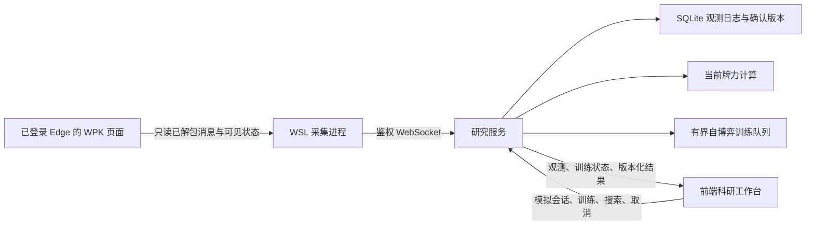

# WebSocket 科研链路

本机开发、运行和测试均使用 WSL2 Ubuntu-24.04 的 Linux 工具。Windows Edge 是已登录的页面客户端。当前原型在 loopback 验证；公网 WSS、多用户认证与生产部署尚未实现。

## 当前已实现的数据流



端点为 `ws://127.0.0.1:8765/v1/research/stream`，信封版本 `1.2`。原有 HTTP `1.1` 契约保持兼容。实现使用 FastAPI 的 [WebSocket 支持](https://fastapi.tiangolo.com/advanced/websockets/)；Uvicorn 的消息上限同时配置为 256 KiB，见其 [设置说明](https://uvicorn.dev/settings/)。

## 运行

项目须位于 WSL 原生文件系统。仓库默认分支 master 仅有初始文件，本实现基于 dev。

```sh
uv sync --frozen
npm ci
uv run --frozen texas-analysis
```

服务会打印令牌文件的路径，不打印令牌。开发终端另行运行：

```sh
npm run dev
node adapters/wpk/stream.mjs artifacts/local/session.token
```

采集进程要求 Windows Edge 已以独立调试配置启动、9223 端口可由 WSL 访问，且用户已自行登录 `https://h5.wpk.com/` 并进入牌桌。它只选择该网址的页面，不读取其他标签页。页面获得只读观察代码，后端访问令牌留在 WSL 进程中，不注入 WPK 页面。

在前端输入本地令牌并检查连接，即可收到当前观测。模拟牌局的训练、行动、策略查询和取消也通过同一 WebSocket 连接交互。训练可推送排队、运行及结束状态；没有逐迭代进度。开发时若修改令牌或重启服务，需在界面更新令牌后重新连接。

`Ctrl+C` 停止采集；正常退出会恢复客户端原方法并移除观察绑定。页面关闭、后台断线、数据验证失败或本地队列超限都会停止采集、使前端结果失效。异常终止后如页面残留观察器，刷新 WPK 页面并重新登录/进入牌桌后再运行；不要覆盖另一个活动采集进程。

## 消息格式

先发送认证帧，令牌不出现在 URL：

```json
{"type":"auth","token":"YOUR_LOCAL_TOKEN"}
```

认证成功返回 `{"type":"ready","schema_version":"1.2"}`。请求使用唯一 `id`，响应按 `id` 关联，允许乱序返回：

```json
{"type":"request","id":"request-1","method":"POST","path":"/v1/sessions","body":{"seed":0}}
```

服务器只允许现有研究操作，路径不能指定远端 URL。每连接最多 4 个在途请求；计算继续使用现有 2 个共享限流槽，训练仍由有界队列执行。客户端取消等待后会忽略对应迟到响应；不自动重发状态修改命令。模拟行动继续使用 `event_id` 与 `expected_version`，旧版本分析返回 409。

`POST /v1/observations` 接受 `ObservedSnapshotSchema` / `ObserveRequest`：

- `source_id` 和严格递增 `sequence`：采集进程作用域和交付序号。
- `table_id`、`hand_id`、`hero_id`：脱敏作用域标识；`street` 明确区分各街、摊牌、两手之间与未知阶段。
- `hero_cards`、`board`、`players`：自己的手牌、公共牌、公开座位和筹码；未知牌与金额保持 `null`。
- `actions`：源动作 ID、操作者、确认类型、增量、可用时的本街累计投入及原始 `source_round`。重连历史按源 ID 回填，冲突或缺口不伪装成完整历史。
- `to_act_player_id`、`legal_actions`、`call_amount`：当前行动者及仅在自己行动时可用的操作、跟注增量。
- `min_raise_reported`、`max_raise_reported`：客户端原始范围字段；未完成口径核查，不能自动解释为 raise_to。
- `history_complete`：仅在观察到本手开始且源动作连续时成立；不是服务器规则状态完整性的证明。

动作确认后清除上一位行动者的选项；摊牌和两手之间不暴露可行动者或下注选项。换桌、换手与换账号均处理作用域变化。新手费用先于发牌时暂存，不归到上一手。未公开对手牌、昵称、头像、Cookie、WPK Token 和密钥不进入该通道。页面刷新、导航或执行上下文变化会停止旧观察器，要求重新同步。

服务器先提交 SQLite，再返回 `state_version` 确认；同来源同序号同内容幂等，不同内容或序号缺口返回 409。SQLite 文件权限为 0600。采集端在 `artifacts/local/wpk-observations.jsonl` 记录必要快照及确认，文件权限同为 0600，由 Git 忽略。

## 推送、一致性与覆盖

`observation` 推送当前快照和服务器接收版本；`observation_analysis` 带同一版本的牌力结果及策略覆盖状态。新版本取代旧计算，过期结果不推送；新订阅者可取得当前快照和已完成的当前版本结果。采集断开会推送 `observation_status`，界面清除旧结果。

观察版本表示服务器已接收的科研数据版本，不表示八人规则已经重建。现有模拟器的权威状态、合法动作、模型覆盖和 WPK 观察状态分别管理：标准小型博弈可训练和返回经覆盖检查的研究策略；当前 WPK 第三盲/蘑菇观察返回 `decision.status=unsupported`、空动作和具体缺失项。不会为缺失真实状态自动发牌，也不会把普通德州模型标作目标玩法已验证策略。

当前观测可自动计算自己的当前牌型、nuts 和合法对手组合比较；不把牌力当作下注 EV。训练、对抗和论文验证仍需固定规则、模型版本、预算与信息边界。

## 原型限制与检查

采集进程与侧栏连接目前不自动重连/补传：断线立即停止，保留未确认日志，人工重新连接并明确缺失历史。新采集源从新作用域开始，不能把断线期间的动作猜成完整记录。此实现不是 MV3 后台持久队列或生产采集器；侧栏关闭后采集端和后端仍可记录，但展示连接需重新建立。

未在公网部署，未实现多租户隔离或目标八人策略覆盖。原始抓包、研究观测日志、令牌和模型产物不得随补丁提交。

```sh
npm run check
uv run --frozen ruff check .
uv run --frozen ruff format --check .
uv run --frozen pytest
```

测试包含鉴权、Origin、二进制及超大帧、训练完成推送、模拟人机闭环、旧版本拒绝、持久确认、幂等/冲突/缺序、隐私字段拒绝、慢结果丢弃、当前结果补发及只读观察器的透明性。真实 Edge → 后端 → 前端链路另行执行本机冒烟，不将真实账号数据放入测试仓库。
