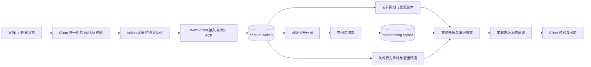

# 系统与代码地图

## 产品边界

Pre1.0 / 0.8.3 是单机内部预览。Chrome 客户端负责观察、持久队列和展示；Python 服务负责规则、账本、策略、画像和训练。插件没有自动下注职责。默认通信为 localhost WebSocket；外网部署不能直接暴露免令牌本地服务。

## 运行入口与依赖

- `Client/extension/background.ts`：MV3 后台入口，协调采集意图、标签页和恢复。
- `Client/extension/capture.ts`、`capture-recovery.ts`：CDP 附着、Worker/iframe 目标、采集状态与恢复；单手缺口不应变为全局永久失效。
- `Client/extension/wpk-page.ts`、`wpk/page-probe.js`、`wpk/probe-bridge.ts`：读取页面已解码的可观察业务状态，跨页面边界传递并验证。页面输入不可信。
- `Client/extension/wpk.ts`、`capture-state.ts`：业务转换、手号与行动状态；开局费用可以早于新手快照到达。
- `Client/crates/capture-core`：Rust/WASM 消息边界、序号、ACK、容量和 WPK 契约验证。
- `Client/extension/db.ts`：IndexedDB 持久队列；`transport.ts`：双流 WebSocket、能力协商、ACK、重发与重连。重新连接不能重复计数。
- `Client/extension/recommendation.ts`、`sidepanel.tsx`：严格解析并按来源、手号、序号及过期时间展示建议；新业务、断线和停止均作废旧建议。
- `services/analysis/src/texas_analysis/__main__.py`：进程启动和环境变量；`app.py`：FastAPI 路由、生命周期、后台学习任务、Origin/Host/请求体限制。
- `network_stream.py`：网络与业务流接入、SQLite 持久确认、最新状态及推荐任务。每连接保留一个在算任务和一个最新待算版本，接收与计算分离。
- `capture_contract.py`：业务消息契约；`capture_state.py`：纯状态归约；`capture_replay.py`：根据完整公开事实重建合法下注；`capture_ledger.py`：按事件截止点重建蘑菇权益。
- `capture_recommendation.py`：构造查询、固定策略快照、预算搜索、画像候选比较和动作金额转换。
- `capture_learning.py`：行为机会与样本持久化；`capture_strategy.py`：条件行为训练、整手留出评测、版本发布及回滚；`capture_openings.py`：可信八人公开开局收集。
- `core_training.py`：唯一核心后台 worker、空闲让位、恢复和分布升级；`portable_state.py`：数据导出恢复。
- `research.py`、`storage.py`、`session_profiles.py`、`game_factory.py`、`models.py`：开发工作台的模拟、研究作业和模型接口；不是第二条正式 WPK 采集链。
- `packages/game-core`：整数筹码、公共/完整德州状态、边池及蘑菇会话；`engines/strategy`：抽象、训练、策略与搜索。通用层不导入 WPK 页面对象。
- `apps/workbench`：React 开发工作台；`packages/protocol`：其 Zod 契约与 schema。正式客户端另有严格业务契约，不能只修改工作台 schema 就宣称客户端协议已变更。

## 主数据流

接入先验证消息和单调序号，再同事务更新事件、投影及相应学习数据，然后 ACK。丢 ACK 重发使用原事件去重。原始记录按 Origin/source 隔离；昵称不构成跨会话身份。单次查询只使用当前截止序号之前的事实，迟到结算不能修复过去本应拒绝的建议。

推荐依次要求：无采集缺口、轮到本人、本人牌已知、八席参与、公开下注可回放、现金与蘑菇权益可信、模型规则匹配。查询固定 SQLite 已提交快照，搜索与最终输出共用取消和总期限。返回动作包含本次支付与本街 raise_to，两者不可混用。频率不是胜率。

后台行为学习和开局收集每 30 秒检查数据。开局收集每批最多 64 个本人快照、每手最多 4096 条事件、最多 512 种公开开局；只保存扣费前筹码、权益、等待席和位置，私牌由自博弈重新随机生成。worker 仅在完整迭代之间更新开局分布，首次扩展前备份；总开局上限 1024。容量达到上限要报告，不能丢弃旧模型制造成功。

## 状态、持久化与恢复

`capture.sqlite3` 保存不可变业务事件、投影、画像、条件模型、公开开局登记和处理游标。`core/training.sqlite3` 保存遗憾、策略累计、下注轮及元数据/RNG。`core/progress.json` 是展示状态，不是训练事实来源。启动中暂显零轮不表示数据库被重置。

训练单轮使用有界缓存与临时 SQLite，只有完整迭代才提交主库及 RNG；取消和异常回滚未完成迭代。策略读者固定快照，不与正在写入的半轮混合。同一核心只能有一个 worker，worker.lock 防重复写入。进程信号不能在 worker 被杀后留下无法恢复的锁。

升级检查点必须验证规则、抽象、训练分布与累计迭代来源。旧无前注条目保留在原命名空间，新规则使用 ante4: 前缀；不能重新解释旧累计。原分布加入新开局后，旧累计是热启动，新增分布来源与迭代步骤必须记录。

`export --core-only` 仅导出核心训练，默认完整导出还包含采集与画像。导出使用 SQLite backup 而非复制主文件，manifest 带文件大小和 SHA-256；恢复先验证并写临时目录，再发布到新目录，拒绝覆盖已有数据。两个数据库分别一致，不保证跨库同一事务。完整格式与调用入口见 portable_state.py。

## 运维和修改边界

安装器创建独立 release、切换 current、保留 data，注册用户 systemd。API 和 worker 同一 cgroup 合计 MemoryMax=1G，worker 另有地址空间限制。文件缓存回收不等于 OOM，应查 memory.events 和实际 PID。大库启动全量校验与首次备份可能耗时十余分钟；API 可先恢复，后台训练稍后恢复。

改变采集契约须同时检查 Client、WASM、capture_contract、归约器、回放和协议集成测试。改变金额规则须检查完整引擎、公共引擎、账本、抽象键、迁移与查询。改变策略编码须检查 checkpoint/blueprint、SQLite、CLI 与导出恢复。测试参考后端仅在 Client/tests 使用，不作为交付服务器。
