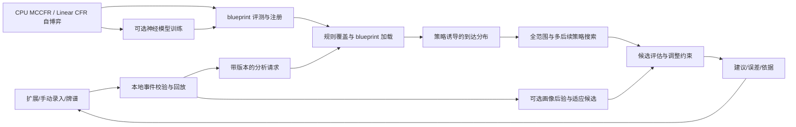

# 以 Pluribus 为核心的决策引擎

状态：已实现离线模拟、自博弈、blueprint/checkpoint、有限博弈全范围搜索和独立评测，具体见 [软件实现结构](software-architecture.md)与[真实算法实验](offline-algorithms.md)。完整六人德州策略尚未充分训练；本文同时保留后续完整目标，不能将全部设计视为已交付。此前已完成 TexasSolver 第三方命令行构建与两个河牌样例验证，并阅读对手建模与策略集成论文、Pluribus 的 Science 正文。用户已明确将“结合玩家画像和博弈策略推荐决策”列为核心能力，并允许大规模计算放在服务器端。规则依据见 [蘑菇规则](mushroom-rules.md)，资料核查状态见 [研究记录](research-sources.md)。

算法优先级已按用户要求确定：**Pluribus 是整个项目的核心算法依据**。围绕其自博弈 blueprint、实时搜索与多后续策略机制构建默认策略引擎；画像是基线之上的适应扩展，蘑菇是状态与收益扩展。TexasSolver 提供局部对照，Deep CFR／ReBeL 等保留为后续研究。先完成关闭画像也可独立验证的核心流程，再评估附加模块的增益。

## 1. 优化什么

优化目标为给定信息、规则、对手模型和计算预算下的长期期望净收益。输出可以是混合策略；不能以当前胜率最高、最常见 GTO 动作或单手盈利最大替代长期目标。

分别输出并评估三种策略：

- 博弈基线：在声明的规则、动作抽象和误差下求解并独立评估；两人零和情形可研究近似均衡与最坏情况保证，多人自博弈结果须另行测量，不能自动称为均衡。
- 模型最佳响应：对当前对手行为后验提高收益，结果依赖模型准确性和对手是否继续采用该策略。
- 实际建议：在模型收益与抗误判约束之间选择，标明调整程度、估计收益、证据与未覆盖情况。

“最优”必须限定场景与假设。有限下注树的最优不等于所有连续尺寸最优，近似价值网络和有限搜索存在误差，多人策略不能套用两人零和的保证。

## 2. 玩家形象的三种含义

| 对象 | 使用的信息 | 在决策中的作用 |
| --- | --- | --- |
| 对手行为画像 | 对手在不同位置、街道、尺寸、筹码、蘑菇池状态下的可观察行为和机会数 | 估计对手拿不同范围时如何跟注、弃牌、加注 |
| Hero 自身行为历史 | 用户过去的公开行动，以及只有用户可知的历史牌谱 | 评估自身偏差；决定哪些信息可以用于建立对手眼中的 hero 形象 |
| 对手对 hero 的可能看法 | 仅该对手有机会观察到的 hero 行动和已公开底牌 | 估计其回应是否随 hero 的公开形象变化 |

不能把 hero 的真实底牌或私有全量记录当作对手已知信息，也不能假定所有对手都记住过去每一手。首版只使用当前共同会话的公开历史；观察范围不明时使用更保守的先验。画像不是要求用户继续按旧风格行动，而是预测对手反应的条件。

## 3. 数据与信念更新

事件日志经规则校验后产生统计机会与训练样本。PlayerModelSnapshot 包含身份作用域、数据截至时间、统计计数、有效样本量、后验参数、模型版本和规则覆盖。每次分析固定快照，不能在同一查询中使用变化中的模型。

对二项机会统计可使用 Beta 收缩，多动作分布可使用 Dirichlet；复杂模型逐步引入分层逻辑回归或神经网络。先按位置、底池类型、街道、有效筹码、蘑菇奖励大小分组，在稀疏组间共享先验。近期趋势与长期画像分别建模，漂移时扩大不确定性。

设 h 为对手底牌，θ 为其行为参数，I_t 为当前可用信息，b_t(h,θ) 为联合后验。对观察到的动作 a_t：

`b_(t+1)(h,θ) ∝ b_t(h,θ) × P(a_t | h, I_t, θ)`

按公共发牌、已知阻断和合法组合继续更新，记录归一化失败等异常。多人手牌后验存在牌张互斥与行动相关性；若采用各玩家范围近似，必须用无重复牌联合采样并记录近似方式，不能将互不相容的独立手牌视为真实联合分布。

多数对手手牌不可见。行为模型的训练需对隐藏底牌边缘化，并用明确标识的模拟数据或合法公开样本辅助；不得将推断牌当作真实标签再自我强化。仅有 VPIP/PFR 无法辨认唯一条件策略。强制亮牌和普通摊牌存在选择偏差，需要记录公开机制，不能直接把公开样本分布外推到所有下注。

## 4. Pluribus 核心与针对性决策

### 4.1 优先建立自博弈与搜索主线

核心职责依次为：规则与信息集 → 动作／信息抽象 → MCCFR 与 Linear CFR 自博弈 → blueprint 保存与加载 → 策略诱导的到达分布 → 多后续策略叶节点 → 限时子博弈搜索 → 独立评测。第 4.6 节记录原文机制，第 8 节给出模块和交付顺序。正文未提供的参数需标记为项目选择，并保留后续与补充材料核对的入口。

先以表格 CFR 在 Kuhn／Leduc 等小型两人零和游戏上校验反事实遗憾、平均策略、最佳响应和可剥削度，再验证采样与线性加权；随后尽早在可穷举多人游戏中跑通 blueprint＋搜索。小博弈是验证工具，不把完成 HUNL 产品或训练专家网络设为多人主线的前置条件。

有限下注抽象、有效筹码、抽水与规则均是策略模型的一部分。首个完整扑克研究目标为有限动作、明确预算的标准六人德州。实际牌局若由多人入池后剩两人，仍需保留此前历史、范围、死钱和边池，不能重置为两人起始牌局。

默认 `PluribusStyleProvider` 表示本项目依据论文构建的引擎，并非官方实现。首版叶节点采用多后续策略选择与 rollout。Deep CFR、ReBeL、价值网络或蒸馏须在主线有可重复基准之后，依据性能与收益证据单独评估。

[TexasSolverProvider](texassolver-review.md) 仅作为标准两人翻后的可选对照工具；其有限运行验证不改变项目核心路线。比较前对齐规则、范围、动作树和预算，核对权重阈值、花色同构、金额、历史路径及许可。第三方输出不是正确性真值，独立可穷举收益与小博弈数学基准仍需保留。

子博弈求解不能只代入 hero 一手真实牌、给对手一个固定范围后声称全局安全；需处理双方范围、到达概率与适用的边界反事实价值约束。忽略这些边界时仅标为条件近似搜索。

### 4.2 比较完整后续收益

对每个合法动作 a（含明确的 raise_to 尺寸）计算：

`Q(I,a) = E[后续净收益 | I, a, 后续 hero 策略, 对手行为后验]`

期望对未知底牌、未来发牌、对手参数和回应共同积分。对手后续可能再加注，hero 后续也会作决策，不能用单次胜率乘当前底池代替整条分支。允许采用求解器、带条件策略的 rollout 和价值网络组合，但结果明确标注方法与误差。

同一决策点、同一单位比较基线与候选策略，并分开报告抽样误差、模型误差敏感性及求解误差。多候选可以共用随机牌面减少比较方差；对相近动作使用独立评估样本或追加预算，避免把选中候选的抽样噪声当作收益提升。

### 4.3 控制对画像误判的依赖

首先计算对手后验下的最佳响应候选，再检验其在先验、近期模型、长期模型和扰动对手下的表现。

可验证的小型两人零和完整博弈中，可研究约束优化：

`最大化 E_(σ_-i ~ posterior)[V_i(π_i, σ_-i)]`

`约束 min_(σ_-i) V_i(π_i, σ_-i) ≥ v* - ε`

这里 π_i 是完整的 hero 策略，σ_-i 是对手策略，v* 是该博弈价值，ε 是允许的最坏收益损失。只有最佳响应和边界可计算、基线误差有界时才能给出对应保证；不能拿一次节点 EV 或策略距离代替这个条件。

大规模或多人场景先采用工程约束：在模型集合上检验收益下界、限制相对基线的策略变化，对样本稀疏、校准差、分布外输入或模型漂移减少调整。可以使用节点混合 `π = (1-λ)π_baseline + λπ_exploit` 作为候选生成办法，但 λ、KL 距离或模型集合压力测试本身都不是不可剥削性证明。

λ 和收益改善门槛通过离线验证选择，随场景覆盖及不确定性变化，不写死“满 100 手即可激进剥削”。模型不可靠时返回规则匹配的基线；若连基线都不覆盖，则返回不支持。需要风险偏好时另设显式目标，不默认把收益方差惩罚伪装成期望收益最大化。

### 4.4 推荐的含义

输出完整混合分布、候选尺寸、可用的 Q 估计、相对基线增益及误差。若给出单次行动选择，应按已验证的建议分布抽样并记录种子用于回放，而非每次挑概率最大的动作。存在测量误差时，收益很接近的行动不应被描述为唯一最优。

解释从计算结果生成：关键机会分母、对手条件回应变化、范围阻断、蘑菇池影响和敏感性。语言模型可帮助组织文字，但不作为数值 EV、策略频率或牌型正确性的来源。

### 4.5 根据已读论文增加专家策略层

在 Pluribus 主线完成独立验证后，依据张蒙等 2022 年论文（DOI 10.16383/j.aas.c210127），研究“离线克制策略池＋在线条件风格匹配＋低置信度回退”作为适应层。画像采集可先建设，但专家训练不阻塞 blueprint 与搜索。详细出处、参数、原文疑点和实验边界见 [论文阅读笔记](opponent-modeling-paper.md)。

在不同对手行为模型上训练或求解专家 π_p；依据位置、街道、行动路径及样本质量计算模板距离 d_p。由于原文式 (2)/(3) 的距离方向与归一化存在疑点，本项目明确采用待验证改造 `w_p = softmax(-d_p/τ)`，而不声称完全复现作者实现。模板全都不匹配时触发未知风格检测，不能将 softmax 输出自动视为置信度。

先对齐所有专家的合法动作和尺寸，再产生 `π_experts = Σ w_p π_p`，用置信度门控 g 与基线构造候选，最后进入第 4.3 节的收益与误判约束检查。小样本、缺失路径、漂移或覆盖不足时降低 g。论文的基础网络来自演化训练，本项目优先使用规则匹配、经过评估的博弈基线作回退；这是设计改造，不自动带来全局安全保证。

TexasSolver 输入范围影响双方持有什么牌，专家模型则描述对手之后如何行动；需要分别建模，不能将“在八种不同范围下求解”当成“八种行为专家已训练完成”。服务端可离线批量训练专家，在线执行较轻的风格匹配与推理，并以限时求解补充基线。

### 4.6 Pluribus 多人基线与搜索

已通过用户上传阅读 Brown、Sandholm 的 *Superhuman AI for multiplayer poker*（Science 2019，DOI `10.1126/science.aay2400`）；用户进一步明确其为整个项目的核心算法依据。完整出处、图 4 的信息集结构、资源和实验口径见 [Pluribus 阅读笔记](pluribus-paper.md)。附件含正文，不含补充材料；尚未复现其精确训练配置或性能。

默认策略引擎采用“离线自博弈 blueprint＋在线深度受限搜索”。原文用改进 MCCFR、早期 Linear CFR 和遗憾剪枝生成粗粒度策略；翻前通常查询 blueprint，翻后及部分翻前树外下注触发搜索。当前下注轮保留细粒度私牌信息，未来轮可抽象。抽象规则、剪枝阈值和搜索预算均须版本化；先建立无剪枝对照，再评估加速方案，不凭正文未列出的参数声称忠实复现。

截断叶节点允许每个仍在牌局中的玩家（含 hero）在四种后续策略中选择：blueprint、偏弃牌、偏跟注、偏加注。选择对其他玩家隐藏；在联合选择下 rollout 得到各玩家收益，再求解包含这些选择的局部博弈。这能检验有限集合中的战略反制，不能用一个固定牌面分数、四个专家的简单均值或各玩家各自最大叶值代替。

根状态按先前求解策略的到达概率构造，首次搜索使用 blueprint 来源；保持牌张互斥与信息集一致。搜索先生成 hero 所有可能手牌的策略，再提取实际持牌动作。基线到达分布与画像产生的行为后验分别保存；替换根分布或后续行为模型属于适应性扩展，需单独评估。

Pluribus 原算法不使用对手身份，也不根据跨手牌风适应对手。第 4.5 节的专家层是本项目另加的机制：后续策略集合用于搜索中的隐蔽选择，风格专家池用于根据观察生成调整候选。两者分别记录 `continuationSetVersion` 和 `expertPoolVersion`，不能混用。候选仍须经过第 4.3 节的误判控制；基线与适应版本分别评测。

原文证据是特定六人规则下的实证强度，未证明多人纳什收敛或绝对最优。按小型多人游戏→有限动作六人实验→画像增强与蘑菇会话扩展推进。基础回放、牌力计算及画像统计可独立交付；策略推荐必须通过当前规则的覆盖与质量检查。

## 5. 蘑菇跨手价值

状态扩展为 `(牌局信息, 全桌范围/画像, 蘑菇池余额, 冻结状态, 小盲位置, 资格, 位置轮转, 会话结束假设)`。采用统一计价的会话收益：

`V(S) = E[Δ常规筹码 + Δ蘑菇净转账 + V(S_next)]`

Δ蘑菇净转账包含缴纳与实际派奖，仅在未包含于筹码余额变化时另计。当前池额只能在符合小盲获奖规则时作为奖励，不能无条件加到所有人的可争夺底池里。非小盲可能通过本手获胜保留池额并在未来成为小盲受益，需要继续价值。

明确有限会话终止、位置轮转、入退桌假设和终局均分；若以有限深度截断，则叶节点需估计余池及未来收益。使用折扣或固定剩余手数会改变优化目标，必须声明并做敏感性分析。最少四人参与的完整蘑菇模式属于多人不完全信息跨手博弈，即使计入池账本后资金守恒，也不能使用两人零和收敛保证。

Pluribus 的单手 blueprint 和后续策略没有蘑菇效用；需在扩展规则下重新求解／训练，并使搜索叶值覆盖后继会话状态。强制亮牌改变下一手可观察历史，也需进入画像回放。先用规则完整、人数与位置轮转固定的小型模拟环境检验价值变化。截图未说明的平分、边池、入退桌和缴纳细节继续按缺失规则处理，不编造真实规则以完成训练。

## 6. 服务器与客户端分工

| 层 | 职责 | 初期部署选择 |
| --- | --- | --- |
| 扩展／本地服务 | 采集、状态校验、整数账本、人工纠错、展示、缓存 | CPU；保留本地回放及基础评估能力 |
| 在线分析服务 | 后验查询、策略库、限时搜索、模型批量推理 | CPU 工作进程；有基准收益后引入 GPU 批推理 |
| 训练作业 | 优先构建 blueprint；之后按需训练对手模型、价值模型与蒸馏 | CPU 并行采样／树搜索；神经模型按需使用 GPU；独立队列 |
| 存储与模型注册 | 脱敏样本、版本化权重、实验指标、覆盖元数据 | 小规模文件与数据库开始，扩容后使用对象存储等服务 |

服务器是默认支持的扩展方式，但本次没有配置端点、部署服务或启动付费训练。小型算法验证先用 CPU；神经模型试验可从单张 24GB 级 GPU、16–32 CPU 核、64–128GB 内存作为待测资源预算起点，并不保证容纳完整德州训练。并发、回放容量和树深按峰值内存、每秒有效样本、验证收益及成本实测缩放，不能照搬第三方 60 进程和 1.2 亿回放容量。

Pluribus 原文报告 blueprint 约 12,400 CPU 核时、训练内存少于 512GB，对局内存少于 128GB；单个子博弈搜索 1–33 秒。它提供 CPU 路线的参考，不能据此保证本项目成本、峰值内存或 p95。缓存查询的 500ms 目标不适用于所有即时重新求解；应区分策略查询、限时搜索与离线精算的预算，实测队列、网络和计算总时长。

在线请求明确截止时间和可用预算；训练不能阻塞在线队列。固定 requestId、handId、stateVersion、rulesVersion、playerModelVersion 和 policyVersion，超时／断线只回退到仍匹配当前状态且覆盖规则的缓存或基线，否则不输出动作。精确缓存键同时包含范围与画像快照、动作抽象、目标函数和预算配置，不复用另一玩家或另一状态的结果。

多人搜索额外记录 blueprint、信息抽象、后续策略集合、专家池版本及根到达分布来源；缓存不能跨这些版本复用。后续策略收益估计携带所有相关玩家的收益向量、种子和抽样误差，避免只优化 hero 分数而破坏原博弈的回应结构。

新增远端接口使用 HTTPS、鉴权、租户隔离和限流；本地 API 继续只监听 loopback。上传数据限于分析所需的规范化状态与作用域化标识；默认不上传原始截图、昵称、账号凭据或无关浏览数据。私人牌谱参与跨用户训练需单独建立明确的数据使用范围与删除机制。用合成自博弈可先完成共享基线训练。

## 7. 训练、评测与发布条件

首轮算法验收先完成数学基准及多人搜索结构验证，再扩展六人对局、最后评估画像和蘑菇增益。以下编号按验证主题组织，执行依赖以第 8 节为准。

1. 数学基准：Kuhn／Leduc 对照已知解或独立实现，报告平均策略的可剥削度、迭代数、种子；验证固定对手最佳响应及收益计算。
2. 对手模型：人工可控的偏紧、偏松、过度弃牌、过度跟注、尺寸偏好和适应型对手，测条件动作 log loss／Brier score、后验覆盖和范围校准；真实数据按时间及会话／玩家作用域切分，防止泄漏。
3. 针对性收益：对照纯基线、无约束最佳响应、受约束调整；用配对发牌、换座、多随机种子与独立对手集合比较净收益及区间。按会话等独立单位估计误差，不将同手动作当独立样本。
4. 鲁棒性：画像错误、身份误合并、样本不足、对手改变打法、不同牌面／尺寸与模型分布外输入时测性能退化。支持精确最佳响应的游戏报告对应损失，大型多人只报告测得的代理指标。
5. 蘑菇效用：固定同一手牌与行动历史，改变池额、小盲位置和剩余会话长度，核对收益变化及无重复记账；规则缺失场景应拒绝策略输出。
6. 消融：分别去掉玩家画像、hero 公开形象、蘑菇状态、继续价值和调整约束，测量各部分是否实际改善决策。专家层另比较纯基线、均匀专家、距离加权无回退和完整门控；测量对手策略切换后的恢复速度，防止只在训练风格池上评估。
7. 服务验证：计入排队、网络、推理和搜索的端到端延迟；重启、取消、超时及迟到结果不会串局。固定设备与预算报告 p50/p95，不直接承诺原设计中的延迟目标已达成。
8. 多人搜索：在可穷举小博弈中比较完整树、固定叶值、单策略延续与多策略延续；验证后续选择不可见、hero 全范围求解、根到达概率及收益向量。独立比较 blueprint、搜索及画像层的收益贡献；多人近似最佳响应结果不作为全局不可剥削性证明。

牌谱历史只显示实际走过的路径，不能直接观察“当时另一个动作”的真实收益。离线策略评估需行为策略概率和覆盖等假设；不满足时以模拟器／独立对局验证为主，不能用模型自己打出的 Q 分数同时作训练目标与成功证据。

每个模型工件带代码提交、数据版本、规则／金额口径、训练配置、随机种子、校验和、评测报告、覆盖与已知限制。只加载可信来源工件。先作为离线复盘候选，达到预先记录的验收门槛后再发布对应能力；收益不稳定时保留实验状态。

## 8. 实现拆分

| 模块 | 建议接口 | 首次交付 |
| --- | --- | --- |
| packages/game-core | legal_actions、apply、observe、payoffs | 可回放规则、玩家信息集、机会事件与收益向量 |
| engines/strategy/abstraction | abstract_actions、bucket_information | 明确版本、当前轮／未来轮范围及树外动作处理 |
| engines/strategy/cfr | traverse、update_regrets、average_policy | 表格对照、MCCFR／Linear CFR 与可配置加速项 |
| engines/strategy/blueprint | save、load、coverage、policy | 可重载的自博弈策略工件和覆盖元数据 |
| engines/strategy/search | build_reach、evaluate_continuations、solve_subgame | 全范围搜索、隐藏后续选择、限时结果及诊断 |
| engines/evaluator | evaluate_policy、rollout、compare | 独立收益计算、误差、完整树对照与配对评测 |
| training | self_play、checkpoint、evaluate、register | 可恢复 CPU 自博弈作业与模型注册 |
| services/analysis | analyze、cancel、health | 版本一致的异步分析、预算和降级 |
| engines/opponent（增强阶段） | snapshot、update、action_likelihood、adapt | 条件行为后验、身份作用域和受约束调整 |

以上为完整职责规划。当前已实现 CFR/MCCFR、blueprint、有限博弈全范围搜索与独立最佳响应；`PluribusStyleProvider` 检查规则和训练信息集覆盖，服务按预算组合 blueprint 与 search，未知节点不生成建议。画像关闭时主线独立运行。实际模块路径、实验规模和未实现项目以软件结构／离线算法记录为准；TexasSolver 不作为默认引擎依赖。

| 算法里程碑 | 交付与验收 | 依赖 |
| --- | --- | --- |
| A0：数学与状态核心 | 两人小博弈核对遗憾／平均策略；多人小博弈核对信息集、合法动作和收益 | 明确模拟规则，不依赖 WPK |
| A1：离线 blueprint | 小型多人自博弈、策略保存／重载、版本与覆盖；检验采样与线性加权 | A0 |
| A2：实时搜索闭环 | 按到达概率建根、hero 全范围、隐藏后续策略选择；与完整树及仅 blueprint 对照，报告收益误差和耗时 | A1；关闭画像 |
| A3：六人德州实验 | 明确筹码、抽象与预算；先测资源，再运行训练与独立对手评测，确认搜索效果 | A2 与完整标准德州规则 |
| A4：画像增强 | 在冻结基线版本上验证针对性收益及误判退化；回退与基线一致 | A3 已有可重复基准；统计采集可提前进行 |
| A5：蘑菇会话 | 扩展状态、收益与后续策略，独立训练和评测跨手价值；画像收益另做消融 | 标准主线已验证且蘑菇规则完整；不以 A4 增益为前提 |

首个完整算法交付是 A0–A2：关闭画像、无需真实玩家牌谱的小型 Pluribus 主线。其重点是可复现的自博弈与搜索结构、独立收益校验及预算行为；不要求用小样本胜率证明成功。随后按 A3 扩大扑克规模，再分别加入画像和蘑菇扩展。补充材料未列明的配置显式标为工程选择，得到资料后逐项核对；不因参数尚缺而改用另一套主引擎。
