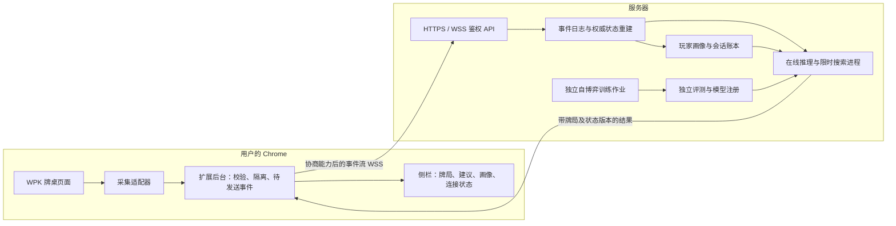

# Chrome 扩展与服务器架构

依据用户明确的部署要求：用户在自己的 Chrome 安装扩展，由扩展实时获取 WPK 牌局数据；服务器承担算法计算、搜索、自博弈训练、画像与模型管理。终端用户不需要安装 Python、uv 或运行本地算法服务。本地研究工作台继续用于开发、测试与复现实验。

前端实现基础现已确定为用户指定的 [TGTO-FronEnd](https://github.com/Keria2026/TGTO-FronEnd)，已核查 CDP 网络采集、WASM、IndexedDB 与 WebSocket 代码。初始核查见 [源码接入核查](tgto-frontend-review.md)；已实现的 Python 接收、持久 ACK、状态协商与 WSS 配置见 [对接说明](tgto-integration.md)。本文件此前的 HTTP 传输建议保留为设计背景，接入默认对齐已有 WebSocket 能力并迁移到 WSS。

本文为目标架构及迁移约定。当前代码已接通网络元数据，尚未接入 WPK 业务数据或部署公网服务器，不能将下列待实现组件描述为已部署。

## 目标数据流

服务器不负责登录 WPK，不需要用户的 WPK 密码、Cookie 或会话 Token。采集在已登录的用户浏览器中进行，仅上传用户有权观察且计算所必需的牌局信息；平台账户凭据不属于业务事件。

## Chrome 扩展职责

- MV3 Service Worker 使用已实现的 chrome.debugger/CDP 采集允许端点的收发消息，Rust/WASM 做轻量检查、IndexedDB 保证先落盘后发送。业务明文适配仍需验证页面已解码观察入口，不能将当前网络元数据视为牌局状态。未知二进制格式不得猜测解析。
- `webRequest` 本身不提供任意响应体或 WebSocket 帧读取能力，不能把申请该权限当作已经取得接口数据。若需要页面执行环境中的消息观察，单独实现、验证并限制桥接范围。
- 站点适配器将消息转换成版本化事件；处理桌号、手牌号、座位、下注、发牌、补码与蘑菇结算。数据校验失败时停止相关建议并提示缺失信息。
- 按 tab、frame、浏览器会话、牌桌和手牌隔离事件；去重指纹包含作用域，不能因另一桌出现相同内容而丢弃事件。
- 扩展后台负责鉴权、上传、确认、取消和重连；待确认事件与消费游标持久保存于扩展来源的存储。MV3 Service Worker 可被回收，内存、定时器或常驻连接不能作为唯一恢复机制。
- 侧栏展示服务器返回的当前牌局状态、合法策略频率、实际计算的收益指标、牌力与画像。训练／研究操作放入单独管理视图，普通使用流程只需连接服务与打开 WPK 牌桌。
- 发布包仅授权目标 WPK 域名及实际配置的服务器 HTTPS 域名；不申请全站权限。生产服务地址由扩展配置控制，WPK 页面消息不能指定任意上传地址。
- 访问令牌仅存在扩展隔离的认证环境，不注入页面或发送到 WPK。页面消息始终视为不可信输入，认证与队列控制不由页面字段决定。

## 服务器职责与部署

| 组件 | 职责 | 部署边界 |
| --- | --- | --- |
| API 服务 | HTTPS、账户认证、作用域授权、输入限额、事件确认和分析调度 | 面向扩展；不在请求进程中执行长时间训练 |
| 状态与账本 | 从事件重建权威牌局、筹码、八人 straddle 状态及蘑菇会话 | 规则版本一致，拒绝缺事件或冲突状态 |
| 在线计算 worker | 牌型／equity、blueprint 查询、范围后验、全范围限时搜索与调整 | 独立资源配额，截止时间包含排队与计算 |
| 训练 worker | 自博弈、抽象构建、checkpoint、对手模型研究与批量评测 | 独立队列和进程，不挤占实时搜索预算 |
| 模型注册 | 工件校验、覆盖元数据、独立评测、版本发布与回滚 | 未经过评测的训练结果不自动替换在线版本 |
| 持久化 | 用户隔离的牌谱、事件、画像、任务及模型索引 | 服务端权限校验，支持导出、删除和保留期限 |

初期可部署在一台服务器上，但 API、在线计算和训练应分开进程／容器并限定 CPU 与内存。CPU 是当前算法路线的基础；GPU 根据实测及后续神经模型需要引入。

服务器多人并发持久化推荐 PostgreSQL；Redis 可用于任务通知、短期缓存和协调，不能作为唯一牌谱来源。工件初期可放受控磁盘，扩展后迁移对象存储。具体编排和资源规格以测量结果决定，不先要求分布式集群。

生产认证需要可撤销的用户会话及训练管理员权限；浏览器扩展不内置共享管理员密钥。令牌所属账户由服务器验证，租户／牌桌访问权不能只相信客户端提交的 ID。训练提交、模型发布和普通分析分开授权。

## 实时传输与一致性

接入采用用户指定前端已有的 WebSocket 鉴权、能力协商、批次与 ACK 契约；生产传输改为 WSS。当前已支持 network_events_v1、network_status_v1、capture_events_v1 和协商的 capture_state_v1（观察状态及未支持覆盖说明），见 [对接说明](tgto-integration.md)。真实策略分析结果仍需独立契约和目标规则验证，不能直接向旧客户端推送未知结果类型。继续支持确认、重连和游标恢复；建立连接本身不保证实时性或不丢事件。访问令牌不放在 URL 查询参数中。

目标事件信封包含 `schema_version`、`event_id`、`session_id`、`table_id`、`hand_id`、`seq`、`source_event_id`（若有）、`observed_at`、`rules_version`、`source`、`confidence` 和经过校验的 payload。采集端观察序号与可用的源序号均需保留；服务器不能仅凭客户端时间或自增 seq 断言没有漏源事件。

服务器在事件持久化后返回接收确认、连续序号和权威 `state_version`。传输采用至少一次投递与幂等处理；冲突 ID、乱序或缺口触发补传／重新同步，不能跳过后直接生成可信建议。修正事件产生新修订并重放，保留审计线索。

分析请求携带 `request_id`、牌桌／手牌标识、`state_version` 与截止时间。结果还包含 `rules_version`、`model_version`、`profile_version`、覆盖、来源及实际预算。新行动使旧请求失效；服务端取消过期任务，扩展仍必须按版本丢弃迟到结果。

断网时扩展清除正在生效的建议并缓存有界事件；重连从已确认游标补传。队列达到上限时显式标记数据缺口，不静默丢弃事件后继续推荐。算法缺覆盖、规则未知或截止时间耗尽时，返回对应状态；只有当前状态确实覆盖时才能回退到匹配的 blueprint。

真实桌观察保持未公开的对手底牌为未知；当前模拟 API 的轮流观察座位能力不能迁入真实牌局接口。后续摊牌只能从发生时起用于画像更新，训练／回测不得泄漏到此前决策。

## 本仓库研究原型与目标架构之间的工作

以下表格描述 Texas-GTO 自有研究前端；生产前端采用独立 TGTO-FronEnd 仓库，其已有采集／持久队列无需在此重新实现。

| 当前实现 | 需要完成 |
| --- | --- |
| `App.tsx` 固定请求 `http://127.0.0.1:8765` | 服务器地址配置、正式认证、后台通信与实时侧栏 |
| Manifest 只有 sidePanel 和 loopback 权限 | 确认采集方式后加入精确站点／服务器权限和相应 content script |
| `background.ts` 仅设置侧栏行为 | 采集消息路由、持久发送队列、确认和恢复 |
| WPK 仅有离线 HAR 结构检查 | 真实消息解析、标准事件映射与完整样本验证 |
| `/v1/sessions` 是合成牌局，自动发牌 | 新增真实事件接入／重放接口，禁止为缺失真实数据随机发牌补全 |
| 本地随机令牌和 SQLite | 服务端认证、用户隔离、生产数据库和迁移 |
| 单进程研究任务与本地工件 | 在线／离线作业隔离、持久调度、模型发布与回滚 |
| 2–6 人、无 straddle 的规则与稀疏策略 | 已确认的八人目标规则、会话状态机、匹配的训练与搜索 |

迁移可先用合成事件验证“扩展 → 服务器 → 版本化结果”的完整链路，再接真实适配器。八人规则与算法训练可独立并行开发，正式上线须同时满足数据、规则与策略覆盖条件。

当前已有本地 API 的鉴权不等于生产鉴权完成；修改监听地址或扩展请求 URL 不能替代上述迁移。发布部署前需要实际服务器资源、HTTPS 域名和可用的脱敏 WPK 样本，当前未部署公网服务。
