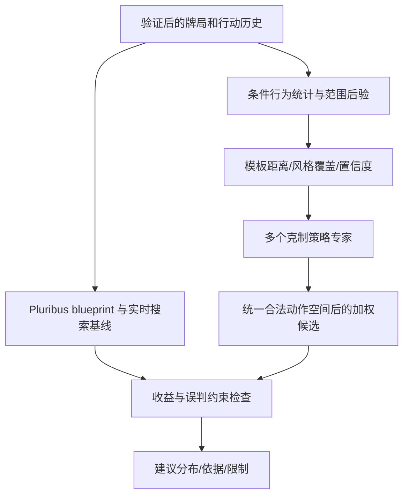

# 《一种针对德州扑克 AI 的对手建模与策略集成框架》阅读与项目映射

阅读日期：2026-10-31。来源为用户上传的 14 页 PDF；正文已读取，关键公式已对照 PDF 图像。以下区分原文内容、原文疑点、本项目改造与尚未执行的实验。

## 1. 文献身份与边界

张蒙、李凯、吴哲、臧一凡、徐航、兴军亮：《一种针对德州扑克 AI 的对手建模与策略集成框架》，自动化学报，2022，48(4)：1004–1017，DOI [10.16383/j.aas.c210127](https://www.aas.net.cn/cn/article/doi/10.16383/j.aas.c210127)。已确认与用户此前给出的 DOI 相同。

上传文件 SHA-256：`a1eb563ed2d69c2c1c222c619860190daee394cc32d9ced5e4a8bc4ff7f1b76a`。下文使用印刷页码，PDF 第 1 页为 1004 页。本次未获取作者代码或训练权重，未复现其实验；也未读取另一份专利 CN112691383A，不将两者视为相同文献。

实验限定两人无限注德州扑克（HUNL），200 BB 深度，每手结束重置筹码并换位置。多人扩展在结论中列为未来研究。其结论不能直接覆盖跨手累积、至少四人启用的蘑菇模式。

## 2. 算法的四个部分

1. **离线训练克制策略**（1007–1009 页、算法 1）：按松紧／激进维度构造已知对手池，针对每类对手演化训练策略网络。遗传算法执行收益评估、选择、交叉和高斯变异，保存优秀个体。
2. **建立对手特征库**（1009 页）：每个克制策略与其目标对手重新交互，按历史行动路径建立树形特征提取器，保存作为风格比对模板。
3. **在线识别对手**（1009–1011 页）：持续记录未知对手的条件行为，比较其当前阶段路径上的特征序列与模板，形成 8×k 的度量矩阵；8 来自两种位置×四条街。
4. **策略集成与回退**（1010 页、图 7）：根据度量结果对多个克制网络的动作分布加权；建模置信度低时使用基础策略网络。

基础策略网络由与全部已知对手对打的演化训练得到，论文没有把它构造成具有已证明可剥削度界的纳什策略。文中“安全策略／下限”是方法角色与经验结果描述，不能据此承诺最坏情况下不输。

## 3. 画像不是一个静态标签

论文的特征提取器是按行动序列动态扩充的树；同一路径更新已有节点，新路径增加节点。金额按底池倍数分成 7 个加注区间，而非仅统计整桌 VPIP/PFR（1007 页）。

| 特征用途 | 原文定义 | 项目启发 |
| --- | --- | --- |
| 策略网络的对手输入 | 访问频率、子树弃牌率、摊牌率、摊牌时对手平均牌力，共 4 维 | 保留机会数与条件状态，不能只保存“松凶”标签 |
| 策略网络的游戏输入 | 同花／顺子相关特征、公共牌对子数、轮次、自身牌力、双方加注比例，共 6 维 | 表示牌面、筹码和当前行动条件；各字段需明确计算口径 |
| 风格匹配 | 弃牌、跟注／过牌、7 种加注的概率，加上摊牌率、期望牌力，共 11 维 | 同一玩家可以在不同位置、街道和历史路径呈现不同风格 |

网络采用对手和游戏两路多层 LSTM 编码，拼接后输入全连接策略网络。表 2 给出两路各 5 个 LSTM 区块、时间步 5，编码输出 200／300 维，全连接输入 500 维、两层各 300、输出 10 维（1011 页）。这些是原实验参数，不是本项目已确定的网络配置。

原文对手池用 10%／30%／50%／70% 的手牌松紧度与保守／激进规则生成 8 个对手；图中的 40% 分界不等于通用 VPIP 阈值。历史摊牌牌力是条件于公开机制的统计，不能当作所有隐藏手牌的无偏分布。

## 4. 训练与实验：报告了什么

- 表 2：100 个体、300 代、生存率 0.25，变异率 0.25→0.05、强度 0.5→0.1；每个对手训练 10,000 种牌局，再交换手牌重打得到每次 20,000 手评估；模板采集每类 100,000 手（1011–1012 页）。
- 基础网络采用三阶段课程：前 100 代对 O1–O4，中间 100 代对 O5–O8，最后 100 代对全部 8 个对手，旨在兼顾容易利用和较复杂的对手（1012–1013 页）。
- 动态对手 Orandom 每 500 手切换策略；评估每组 20,000 手，单位 mbb/h 是千分之一大盲／手，不是每小时。1000 mbb/h = 1 BB/手（1010–1011 页）。

表 3 对动态对手的结果（1013 页，均为论文报告，未复现）：

| 方法 | mbb/h |
| --- | ---: |
| 固定均匀混合专家 Aave | -1068.44 |
| 仅动态集成、无基础回退 Aint | 2738.98 |
| 单一基础网络 Abase | 5105.38 |
| 完整框架 A* | 6359.36 |
| Slumbot 对照 | 3387.13 |

这支持在该实验中“识别＋回退”比盲目混合有效，但不能推广为所有对手均优于均衡策略。表 4 中 A* 对 Slumbot 为 -48.49 mbb/h、对 DeepStack 为 -896.76 mbb/h（1014 页），说明其剥削优势不等于对强均衡近似策略占优。表格没有给出这些均值的置信区间，不能仅据单个均值判断显著性。

表 5 报告 A* 训练约 30GB 存储、约 2000 CPU 小时，评测存储 <0.5GB、平均动作响应 <0.1 秒；作者称训练不需要 GPU（1015 页）。这是原实验资源记录，未在本项目复现，不是完整平台端到端延迟。可借鉴将离线种群训练与在线推理分离的做法，不能据此启动无预算的大规模训练。

## 5. 必须显式处理的原文疑点

### 5.1 距离与集成权重

第 1010 页式 (2) 定义路径上各节点特征的欧氏距离之和 d，越小表示越接近。式 (3) 却写成正号 `softmax(d)`；这会给更远的模板更大权重。该式末尾还将 `1 / Σ exp(d_q)` 写成 `Σ exp(-d_q)`，两者通常不相等。已查看 PDF 第 7 页图像，疑点存在于原排版，不只是文本抽取丢失负号。

本项目拟采用并单独验证的版本为：

`w_p = exp(-d_p / τ) / Σ_q exp(-d_q / τ), τ > 0`

这是本项目工程改造，不能声称已还原作者实际代码。例：d=[0,2]、τ=1 时，近模板权重约 0.8808，远模板约 0.1192。实现必须验证越近权重越大、权重和为 1、所有值有限；使用稳定 softmax。所有模板都很远时，归一化仍会给出某个分布，必须另设覆盖／未知风格检测，不能将相对权重直接叫作置信度。

### 5.2 其他复现缺口

- 原文提到置信度要求，但未给出可直接复现的完整计算公式与阈值；本项目用条件有效样本量、区间宽度、模板覆盖、校准及漂移定义门控，并在独立验证集定阈值。
- 7 个加注区间使用开区间书写，边界值的归属需定义；10 维策略输出与完整合法动作／全下映射也需落实，不能凭描述补成作者原实现。
- 式 (1) 的收益适应度可能为负，但交叉部分称按父代适应度比例随机选择；选择概率如何处理负数需确认。若采用排序选择等替代方式，记录为项目变体。
- 表 4 的 A*→Orandom 为 6359.36，反向项列 -6859.36，数值不互为相反数；不得擅自修订原表或据此建立精确对照标签。
- 文中部分相关工作描述是作者综述观点；不据此把 DeepStack 的反事实价值预测简化成纯动作分类，或将“近似均衡策略”解释成绝对不输。

## 6. 作为 Pluribus 核心之上的适应层

用户已指定 [Pluribus](pluribus-paper.md) 为整个项目的核心算法。本论文承担条件风格建模与策略适应的参考角色；先验证自博弈与搜索主线，再在冻结的基线版本上测量专家层的收益。画像统计可提前采集，专家训练不作为主线前置条件。

1. 保留现有后验与范围模型，增加按规则、位置、街道、动作路径和蘑菇状态分组的风格摘要。树形计数按手牌结算幂等更新，当前未结束手的未来结果不能进入当前画像。
2. 以论文的 8 类对手为可解释模拟起点，增设未见过的风格和变化速度作为留出集。训练专家去适应其条件行动策略；TexasSolver 在不同范围下重算的均衡不能直接充当这些专家。
3. 输出候选 `π_experts = Σ w_p π_p`；所有专家必须共享规则、合法动作与尺寸语义，无法对齐的专家不可混入。对缺失路径回退到更粗粒度统计或基础策略。
4. 使用可信度门控得到 `π_candidate = (1-g)π_baseline + gπ_experts`，再进入独立的收益／鲁棒性检查。g=0 的低置信度回退使用规则匹配且质量合格的基线；若基线也不覆盖，返回不支持。该节点混合没有自动的全局均衡保证。
5. 风格距离先标准化并处理缺失特征与路径长度，拟采用负距离温度权重；温度和门控阈值由留出对手校准。此方案是基于论文的改造，需与论文式写法、均匀专家、无回退、纯基线分别做消融。
6. 蘑菇版本增加池额、缴纳、奖励资格、位置轮转及终止规则，重新训练和评估继续价值。两人 200BB、每手重置的专家不能直接用于多人蘑菇局。

## 7. 下一步算法验收

在主线已有独立评测结果后，先以小博弈验证条件统计、专家加权、置信度回退和有限预算决策，再扩展到已覆盖的扑克规则与人数。保持以下对照：冻结的纯 Pluribus 方法基线、均匀专家、距离加权无回退、完整门控方案，以及可计算时的已知对手最佳响应。固定牌局并换座、多随机种子，报告净收益区间、动态切换恢复速度及对强对手的最坏退化；小博弈数学参照另保留独立的表格解。

实现公式单调性／归一性、非法动作掩码、缺失路径、所有模板均不匹配、负适应度处理、策略切换、样本泄漏和规则不匹配测试。训练先用小种群短作业测 CPU／GPU 吞吐与成本，再决定是否扩到论文规模。本次仅完成文献理解与设计映射，没有执行这些训练或验证论文收益。
