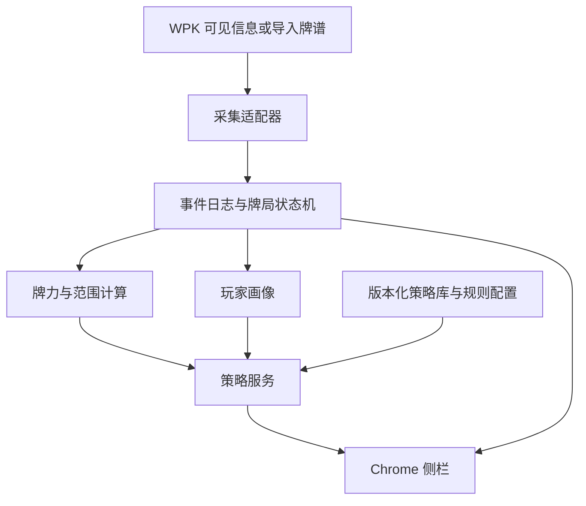

# 德州扑克 GTO Chrome 插件设计思路
版本：v0.1 · 日期：2026-10-31
目标：WPK 平台、“蘑菇游戏”玩法
交付范围：开发设计方案，不代表已实现平台接入或已训练出 GTO 模型。

## 1. 核心结论

建议采用“Chrome 插件负责读取和展示，本地分析服务负责牌力、范围推断和策略计算”的架构。先完成手动录入／牌谱回放的分析闭环，再接入经过验证的 WPK 数据来源，最后加入玩家画像和针对性调整。

必须区分三个能力：
- **牌力与胜率计算**：在已知牌和假设范围下计算，可建立可验证的数学基线。
- **GTO 基线**：来自规则匹配且经过验证的策略库／求解器，输出混合行动频率。
- **针对性调整**：利用对手偏差改变策略，属于剥削性策略，不应继续标为纯 GTO。

系统只能推断未知手牌和诈唬概率，不能确定对手真实底牌。胜率不等于行动 EV，某次胜负也不能证明决策优劣。

实时模式取决于 WPK 的具体客户端、数据可见性和平台许可；目前这些均未验证。复盘与模拟模式可独立开发。产品不包含自动下注、代操作或读取其他玩家未公开底牌。

## 2. 需求与交付映射

| 用户需求 | 设计模块 | 主要输出 |
| --- | --- | --- |
| 读取当前牌局和行动 | 平台适配器、事件记录、状态机 | 手牌、公共牌、位置、底池、筹码、行动序列 |
| 根据 GTO 推荐行动 | 策略库／求解器适配层 | 合法行动、尺寸、频率、可用时的 EV |
| 按入池等行为调整 | 玩家统计与范围模型 | VPIP、PFR、3-bet、范围后验、调整依据 |
| 牌力、可能输给谁、nuts | 牌型评估与 equity 引擎 | 当前牌型、领先／落后组合、当前坚果牌、未来变化 |
| 复用现有仓库 | 引擎验证与可替换接口 | 可用性报告、统一策略接口 |
| WPK 接入 | 独立 WpkAdapter | 识别结果、置信度、版本兼容性 |
| 持续学习玩家形象、诈唬判断 | 历史画像与行动条件推断 | 玩家倾向、价值／半诈唬／诈唬范围及不确定性 |

## 3. 现有仓库核查

仓库：https://github.com/alibabamayun888/poker-gto-trainer

本次读取了默认分支的 README、COPYING、RESPONSIBLE-USE 和完整递归文件树。返回树 SHA 为 `e15de2009c42c12de5f93d7d7eda9a3866879f67`，文件树未截断。未运行构建、未审计全部文件，以下结论仅针对本次公开快照。

| 项目 | 核查发现 | 对设计的影响 |
| --- | --- | --- |
| README | 宣称 CFR、深度学习、多人对战和毫秒级决策 | 作为作者描述，不作为已验证能力 |
| 执行入口 | 文件树未见 README 所述 main.py、requirements.txt、tests/、poker_gto/ | 快速开始无法据此确认可运行 |
| 模型与训练 | 未见 models/gto-v1.pt、训练配置和对应算法源码目录 | 不假定已经提供可部署模型 |
| 现有文件 | 可见构建配置、文档、图片、基准和打包文件 | 不等于扑克求解器可复用 |
| 许可 | COPYING 为 BSD 三条款文本，版权归属写明 Google | 复用前逐文件核查来源、版权和第三方许可 |
| 使用说明 | 要求研究、学习及授权开发不违反平台规则 | 平台接入需单独确认使用条件 |

**工程决策：不把该仓库列为必需依赖。** 设立 `StrategyProvider` 接口，未来拿到真实可运行实现后再替换。现阶段先做牌力与复盘 MVP；没有可信策略来源时明确显示“启发式分析”，不得将规则引擎包装为 GTO。

## 4. 开工前必须确认的规则

“蘑菇游戏”不是足够完整的规则定义，不能直接等同于普通现金桌，也不假定其具体惩罚机制。

| 待确认信息 | 为什么会改变实现 |
| --- | --- |
| WPK 准确版本、官方入口、网页版／桌面端／手机端 | Chrome content script 只能直接处理适配网页；原生客户端需要另一套采集方案 |
| 蘑菇获得、消除、结算和退出规则 | 决定额外收益／惩罚函数以及是否跨手影响 |
| 结算是否与其他玩家的蘑菇状态有关 | 可能要求记录全桌状态，不能只记录自己 |
| 桌上人数、盲注、前注、straddle、有效筹码 | 改变翻前范围、行动顺序和求解场景 |
| 抽水、封顶、特殊费用、保险、多次发牌 | 改变效用、分池和胜率显示口径 |
| 现金局或锦标赛、是否需要 ICM | 筹码 EV 与奖金 EV 不一定一致 |
| 历史牌谱导出能力、可见稳定玩家 ID | 决定数据完整性和跨局画像可靠性 |
| 平台对 HUD、OCR、实时辅助的具体规定 | 决定允许上线的模式 |

建议准备：规则说明、完整一手的行动记录、各街界面样例、含全下边池和蘑菇结算的样例。设计阶段不需要登录凭据。

若蘑菇影响跨手收益，状态增加 `mushroomState`、结算周期及规则版本。行动价值应考虑：

`Q(s,a) = E[本次筹码净变化 + 本次蘑菇结算净变化 + V(后继状态)]`

所有收益统一计价，避免蘑菇处罚同时计入筹码与额外项造成重复计算。只有确定“无未来影响、仅本手固定奖惩”时才可简化成单手效用。普通德州策略在该模式下只能作为参考基线，不能宣称是蘑菇玩法均衡策略。

## 5. 总体架构



建议技术栈：

| 层级 | 初期选择 | 说明 |
| --- | --- | --- |
| Chrome 扩展 | TypeScript、React、Manifest V3 | 侧栏展示、页面适配、消息校验 |
| 状态协议 | JSON Schema 或等效运行时校验 | 前后端共用字段和版本 |
| 本地 API | Python、FastAPI | 便于概率模型与评估实验 |
| 精确牌力核心 | 经验证的评估库，必要时 C++／Rust／WASM | 先核对牌型正确性，再优化吞吐 |
| 本地数据 | SQLite；插件配置使用 chrome.storage | 原始事件、画像快照和模型版本分离 |
| 策略来源 | 版本化预计算策略或独立求解服务 | 覆盖范围外返回不支持 |
| 任务执行 | 后端工作进程 | 不在扩展后台承担长时间训练 |

扩展 Service Worker 按可中断、可恢复设计，不能把唯一状态只放在内存。页面重载或后台重启后由事件日志恢复。本段为架构选择；Chrome API 的具体权限和最低版本在实现时按官方文档核验。

## 6. 牌局读取与状态重建

### 6.1 数据来源优先级

1. 平台正式提供、允许使用的牌谱或接口。
2. 已确认网页中的可见 DOM 信息，采用增量观察和定期快照校验。
3. 对用户授权的可见画面做截图识别，按牌桌区域进行 OCR／牌面分类。
4. 手动录入作为稳定降级入口。

Canvas／WebGL 牌桌不保证能由 DOM 直接读取。若 WPK 仅有原生客户端，Chrome 插件本身不能读取其界面；可另评估用户授权的屏幕采集或本地伴随程序，这属于额外范围与工期。无需假设或设计绕过客户端保护的采集方式。

### 6.2 必采字段

- 会话、牌桌、手牌编号；按钮座位、盲注、前注、规则版本。
- 各座位玩家稳定标识（若可见）、昵称、是否参与本手、筹码、已投入额。
- 自己两张底牌、各街公共牌、当前街、轮到谁行动。
- 每次 fold/check/call/bet/raise/all-in、下注增量与下注到多少。
- 主池与边池、未跟注返还、最小合法加注、可行动玩家。
- 蘑菇状态及可见结算、摊牌公开手牌；未知底牌保持 null。

### 6.3 状态机与可靠性

状态流：等待开局 → 翻前 → 翻牌 → 转牌 → 河牌 → 摊牌／无人跟注结束 → 结算。全下可跳过后续下注，但仍需要处理发牌和分池。

以事件溯源存储：`handId + sourceEventId` 去重；无事件 ID 时使用序号和稳定指纹。多桌按 `sessionId/tableId/handId` 隔离。每次归约生成递增 `stateVersion`。

关键校验：已知牌不重复、公共牌数量合法、筹码守恒、行动者有效、跟注额不为负、加注与重开行动规则正确、边池资格正确。OCR 单帧不稳定时等待一致观测，不凭画面变化直接制造下注事件。

漏事件、冲突、低置信度或关键筹码未知时停止推荐，显示“需要补全牌局”，保留原始证据并允许人工纠正。不能把未知筹码或缺失底池默认为 0。修正后重放事件，作废旧分析。

## 7. 牌力、胜率、落后组合与 nuts

### 7.1 显示四类不同指标

| 指标 | 含义 |
| --- | --- |
| 当前牌型 | 已有牌可组成的最佳五张：对子、两对、顺子等，包含踢脚牌 |
| 当前相对牌力 | 对指定范围，目前领先／平局／落后的权重 |
| 最终 equity | 发完剩余公共牌后的期望底池份额 |
| Nuts 状态 | 当前牌面下没有合法对手组合能严格击败的最佳牌力 |

翻前不足五张，不伪造当前五张牌型。平局收益按共享人数分配，不能把平局全部算赢。主池和边池分别按可争夺资格计算权益，多次发牌另外处理。

### 7.2 计算流程

1. 排除自己底牌、公共牌与其他合法已知牌，建立剩余牌堆。
2. 枚举对手合法两张组合，并赋予范围权重。
3. 河牌单挑通常可做精确组合遍历；前面街道或多人使用预算受控的抽样。
4. 多人抽样必须保证各玩家手牌和公共牌互不冲突，不能独立抽完后保留重复牌。
5. 返回样本数、随机种子、算法版本和抽样标准误；范围不确定性另外说明。

`equity = E[在目标底池中获得的份额]`

### 7.3 “我会输给哪些牌”

输出当前击败自己的手牌类别、具体合法组合及其范围权重。例如只列“所有两对”不够，必须检查牌面、踢脚和阻断牌。分别显示：
- 当前已领先自己的组合；
- 当前落后但未来可能反超的组合；
- 平局组合；
- 范围假设下的加权占比。

当前 nuts 与最终不可被反超是两件事。分别展示“当前理论 nuts”“考虑自己阻断后的对手最佳可能牌”“在推断范围内的最佳牌”，不要将范围外的合法组合从理论 nuts 判断中删掉。未来牌可按有利／不利 runout 展示；outs 要排除会同时让对手成更大牌的污染 outs。

## 8. GTO 基线与行动推荐

### 8.1 输入必须完整

策略查询至少包含规则、人数、位置、有效筹码、抽水、底池类型、公共牌、下注历史、各玩家范围和合法动作。只提供“手牌＋公共牌＋底池＋跟注额”不足以确定策略。

首版限定：标准规则、单挑底池、明确筹码档位和有限下注尺寸；翻前库与翻后库分别标明覆盖范围。多人底池和蘑菇跨手博弈单独扩展，不能套用单挑 CFR 的均衡保证。

### 8.2 Provider 的输出

输出动作集合及频率，例如 fold/call/raise_to 的概率分布。频率总和为 1；每个动作都必须合法。EV 仅在引擎真实提供且口径一致时显示，标明 bb／筹码单位及相对当前决策点的净增量。

必须返回 `strategySource`、`rulesVersion`、`modelVersion`、覆盖状态和质量标签：
- 已验证策略库；
- 限时近似求解；
- 启发式基线；
- 不支持／数据不足。

不把动作概率叫作“预测准确率”。“跟注频率 70%”也不是“70% 能赢”。

### 8.3 算法路线与限制

优先采用可复现的策略库；若自行研发求解器，先在小型两人零和扑克模型上验证 CFR／CFR+，再扩大牌面和下注抽象。实时从零求解完整无限注多人德州不作为 MVP 承诺。

下注尺寸超出策略树时记录偏离程度；不得简单四舍五入后宣称精确匹配。允许重新求解或降级为近似分析。限时求解应返回实际预算和收敛诊断，不根据固定耗时宣称“达到 GTO”。

胜率只能支持有限判断。例如无抽水、无后续下注且跟注关闭行动时，若 P 是跟注前可争夺底池（含对手下注）、C 是跟注额：

`EV(call) = equity × (P + C) - C`

`盈亏平衡 equity = C / (P + C)`

有后续下注、边池、抽水或蘑菇奖励时，必须扩展收益计算。仅靠 equity 不能推导最优下注尺寸。

## 9. 玩家画像与持续学习

### 9.1 统计设计

| 指标 | 分母与注意点 |
| --- | --- |
| VPIP | 有完整可观察翻前记录的有效手数；盲注／前注不算主动入池 |
| PFR | 有完整翻前记录的有效手数；标记主动加注 |
| 3-bet | 实际拥有首次再加注机会的次数，而非全部手数 |
| Fold to 3-bet | 真正面对 3-bet 且可决策的次数 |
| C-bet／Fold to C-bet | 对应街道实际可持续下注／面对持续下注的机会 |
| 激进频率 | 明确 bet、raise、call、check、fold 的计入口径 |
| WTSD／W$SD | 到达翻牌后去摊牌／实际摊牌样本，处理全下和分池口径 |
| 尺寸倾向 | 按街道、位置、底池类型、筹码深度和蘑菇状态分组 |

画像显示分子、分母、时间窗和区间，不能仅显示“松凶”标签。样本稀疏时向群体先验收缩。昵称可能重复或变化，无稳定 ID 时只建立当前会话画像，不自动跨账号合并。

### 9.2 贝叶斯更新与范围推断

二项统计可用 Beta 先验：成功 x 次、机会 n 次后，后验为 `Beta(α+x, β+n-x)`。超参数来自离线验证，不随意用少量手数给出确定标签。时间衰减统计需要标注有效样本量，区间为近似估计。

每个对手维护合法两张组合的概率分布：

`P(h | a,s) ∝ P(a | h,s,玩家模型) × P(h | 既有行动历史)`

牌面和阻断牌剔除不可能组合。只有 VPIP、PFR 不能唯一恢复范围，需要条件行动模型与先验。

每手结算后更新统计，后续手使用新画像；当前手的行动用于更新当前范围。离线训练和回测只能使用决策当时已知的数据，不能泄漏后续摊牌或未来历史。

### 9.3 针对性调整

采用保守混合方案：

`π_final = (1-λ)π_baseline + λπ_exploit`

λ 随有效样本量、模型校准、场景覆盖和分布变化调节，并设上限。混合只是风险控制启发式，不能保证仍然均衡或安全不可剥削。画像不可靠时 λ 回到 0。界面同时显示基线与调整结果及原因。

## 10. 诈唬判断

输出“当前行动下范围构成估计”，不输出“已经识破对方”。

- 价值牌：在模型假设下，下注主要从较弱继续范围获得价值的组合。
- 半诈唬：当前通常落后，但有改善机会的组合。
- 纯诈唬：当前摊牌价值较低，主要依赖弃牌收益的组合。
- 无法明确分类：保留为混合／不确定组合，避免强行二分。

`P(bluff | action, history, board, profile) = Σ P(h | evidence)`
求和对象为当前场景定义的诈唬组合。薄价值下注、保护性下注以及对手误判都可能导致标签边界不清。

参考特征：下注序列、尺寸、牌面结构、阻断牌、位置、有效筹码、历史条件倾向和蘑菇压力。行动耗时易受网络与多桌影响，不作为高权重核心特征。

弃牌后未亮牌不是已证实诈唬；对手赢下底池也不是价值牌证据。摊牌样本有选择偏差，不能拿其诈唬比例直接外推全部下注。用时间切分测试、Brier score／log loss 和校准曲线评价；未达到校准要求时只展示范围分析，不展示精确诈唬百分比。

## 11. 数据模型与接口

### 11.1 核心对象

| 对象 | 关键字段 |
| --- | --- |
| RuleProfile | ruleId、version、盲注、抽水、人数、蘑菇规则 |
| Hand | sessionId、tableId、handId、起始筹码、时间、规则版本 |
| ActionEvent | eventId、seq、street、actor、type、amountDelta、amountTo、source、confidence |
| GameState | stateVersion、heroCards、board、players、pots、toAct、legalActions、mushroomState |
| PlayerProfile | scopedPlayerId、统计计数、机会数、时间窗、模型版本 |
| Analysis | requestId、stateVersion、equity、nuts、ranges、actions、quality、versions |

筹码使用最小单位整数，bb 仅作展示与归一化；区分本街投入、整手投入、跟注增量与加注到。每个边池记录金额和有资格争夺的玩家。每条推断保留输入摘要和规则版本用于回放。

### 11.2 建议接口

- `POST /v1/events`：提交事件批次，幂等写入并返回状态版本。
- `POST /v1/analyze`：提交已验证状态，返回分析结果或后台任务 ID。
- `GET /v1/analysis/{requestId}`：获取同一任务结果。
- `GET /v1/players/{scopedId}/profile`：返回统计、样本量和区间。
- `POST /v1/hands/import`：导入完整牌谱。
- `GET /v1/health`：能力、版本和服务健康状态。

分析响应约定示意（不含虚构策略数值）：

```json
{
  "requestId": "example-request",
  "handId": "example-hand",
  "stateVersion": 12,
  "status": "insufficient_data",
  "strategySource": null,
  "actions": [],
  "missingFields": ["effectiveStacks", "rules.mushroomSettlement"],
  "warnings": ["策略所需输入不完整"]
}
```

请求以牌局 ID、版本、规范化输入、范围摘要和模型版本形成缓存键。迟到结果若版本不匹配直接丢弃；新行动取消旧任务。分析超时显示未完成，不能继续将上一节点建议当作当前建议。

## 12. 插件界面与运行安全

侧栏按四个区域组织：
1. **牌局**：手牌、公共牌、位置、底池、待跟注额、识别状态，可手动纠正。
2. **策略**：基线频率、调整频率、尺寸、可用时的 EV、来源与覆盖状态。
3. **牌力**：当前牌型、equity、nuts、击败自己的组合和危险后续牌。
4. **玩家**：逐座位画像、机会样本数、条件倾向、范围构成。

侧栏突出“当前手＋当前街＋状态版本”，多桌切换不得复用其他桌的建议。过期、识别不足、服务离线、不支持规则均显示明确状态。

权限按功能申请：仅指定站点、配置存储、侧栏；截图或本地通信单独评估。不开启全站读取。页面消息属于不可信输入，校验来源和字段，不能直接触发本地任意操作。

本地 API 仅绑定 loopback，使用随机访问令牌、精确 Origin 校验、请求大小限制；不可把“运行在本机”视为无需鉴权。默认本地保存历史与画像，提供删除、导出和保留期限；不上传账号凭据或无关浏览记录。

## 13. 分期开发计划

以下为小型团队的粗略工作量估计，依赖规则与样本齐备，不是上线日期承诺。

| 阶段 | 预计工作量 | 交付与退出条件 |
| --- | --- | --- |
| P0 可行性验证 | 3–5 工作日 | 明确客户端、数据来源、蘑菇规则；仓库可用性结论 |
| P1 离线分析 MVP | 1–2 周 | 手动／牌谱输入、状态机、牌型、nuts、范围 equity、回放 |
| P2 Chrome 与 WPK 适配 | 1–3 周 | 单一已确认界面版本、事件采集、侧栏、识别校验和降级 |
| P3 策略基线 | 2–4 周 | 接入现成可信策略源，标明覆盖、频率与版本 |
| P4 玩家画像 | 1–2 周 | 条件统计、贝叶斯收缩、范围更新、画像回放 |
| P5 针对性与蘑菇扩展 | 2–4 周以上 | 特殊收益建模、离线对照、校准后才开放调整 |

各阶段可部分重叠。自行训练高质量完整策略源、原生客户端采集、多人大规模求解不包含在上述接入估算中，应另立研发项目。

首版优先：一桌、一个界面主题、完整事件历史、单挑底池、规则明确、可手动纠错。多人底池先提供牌力与条件胜率，未覆盖的策略节点不输出 GTO 标签。

## 14. 验证与验收

以下是建议验收目标，不是已测性能。

| 类别 | 验证方法与目标 |
| --- | --- |
| 牌型 | 枚举全部 2,598,960 个五张组合，验证分类计数；七张结果与独立实现交叉检查 |
| 边界规则 | A2345、公共牌成最佳五张、踢脚、平局、全下不足额加注、边池及返还的黄金样例全部通过 |
| 状态重建 | 至少 200 手人工标注回放，覆盖漏帧、乱序、重复、重连和换桌；所有已知冲突必须阻断建议 |
| 视觉识别 | 按牌面／金额／玩家分别统计准确率和拒识率；建议关键字段准确率目标 ≥99.5%，不以平均值掩盖金额错误 |
| Equity | 可精确求解样本作为参考；报告抽样误差与范围假设，不将统计置信区间当作模型真实误差 |
| 策略 | 全部动作合法、频率归一、版本可追踪；未支持规则必须降级 |
| 玩家统计 | 使用人工算例校验各指标机会分母，检验重放后不重复累加 |
| 诈唬模型 | 时间切分验证，与常数先验基线比较校准和损失；不足则保留实验状态 |
| 性能 | 固定并记录设备；状态确认后缓存策略建议 p95 <500ms、预算内 equity p95 <2s，超时明确退出 |
| 故障 | 断网、服务重启、页面刷新、迟到响应和多桌切换不串局、不显示过期建议 |
| 蘑菇效用 | 同一行动在不同蘑菇结算状态下有可解释变化；结算账目无重复计入 |

扑克策略质量不能以“击败随机对手”或少量盈利证明。小型两人零和模型可评估可剥削度；复杂多人场景使用声明清楚的代理指标和重复对照实验，不把代理指标描述成均衡证明。

## 15. 建议项目组织

| 路径 | 职责 |
| --- | --- |
| apps/extension | 插件入口、侧栏、权限与消息 |
| packages/protocol | 状态、事件、接口 schema |
| packages/game-core | 规则、金额、合法动作、状态归约 |
| services/analysis | 分析 API 和异步任务 |
| engines/evaluator | 牌型、nuts、范围 equity |
| engines/strategy | StrategyProvider 与策略源适配 |
| engines/opponent | 画像统计、条件范围、校准 |
| adapters/wpk | 已验证平台版本的采集逻辑 |
| fixtures/hands | 脱敏牌谱与黄金测试样本 |
| docs | 规则说明、数据字典、验收与模型卡 |

## 16. 第一轮开发决策

优先完成 P0 和 P1：确认 WPK 的真实数据入口与蘑菇规则，同时开发可回放、可校验的数学核心。以完整事件历史作为所有高级能力的基础，以可替换策略接口隔离现有仓库的不确定性。

正式进入实时策略阶段前，应能回答：输入是否完整、规则是否匹配、策略从哪里来、覆盖哪些局面、玩家样本是否足够、结果是否仍对应当前行动节点。任何一项缺失都必须在产品上体现，而不是由模型补造。

## 17. 来源与核查范围

已读取的仓库一手资料：
- [README](https://github.com/alibabamayun888/poker-gto-trainer/blob/main/README.md)
- [递归文件树 API](https://api.github.com/repos/alibabamayun888/poker-gto-trainer/git/trees/main?recursive=1)
- [COPYING](https://github.com/alibabamayun888/poker-gto-trainer/blob/main/COPYING)
- [RESPONSIBLE-USE](https://github.com/alibabamayun888/poker-gto-trainer/blob/main/RESPONSIBLE-USE.md)

本次公开网页搜索未取得可用结果，未核实 WPK 官方入口、平台条款或蘑菇规则，亦未验证 Chrome 当前 API 细节。文中架构、工期与验收阈值是设计建议；仓库性能数字未复现，不作为本项目能力依据。实施时应补充 Chrome 官方扩展文档、所选求解器算法资料及 WPK 具体规则来源。

