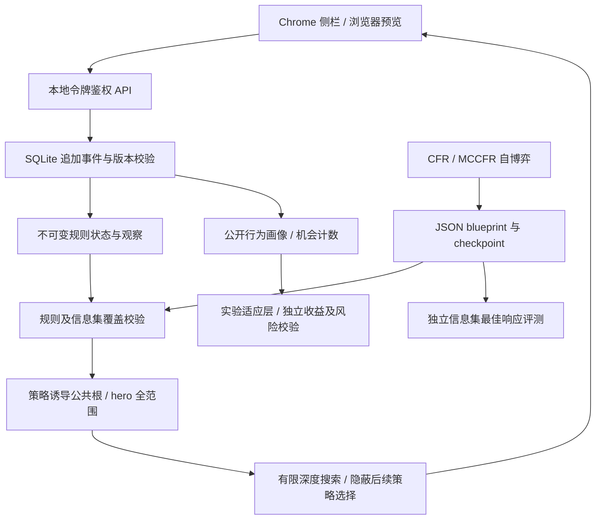

# 软件实现结构

当前为可运行的离线研究工作台。算法依据是 [Pluribus 正文](pluribus-paper.md)，实现参数与实际实验见 [离线算法说明](offline-algorithms.md)。真实网站输入未接入；所有 HTTP 牌局是显式创建的模拟手牌。

## 数据与算法流程

规则／训练／评测使用同一 Python 博弈接口，但最佳响应单独实现，不复用 CFR 遗憾表来估计自身误差。TypeScript 负责交互和传输校验。没有第二套前端扑克结算实现。

| 模块 | 已实现 | 当前限制 |
| --- | --- | --- |
| `game-core` | 2–6 人 Kuhn、两人 Leduc、2–6 人标准无限注德州；整数筹码、短全下重开、边池与返还；牌型和范围 equity | 无抽水／straddle／多次发牌；不是 WPK 规则映射 |
| `strategy` | CFR、external-sampling MCCFR、线性迭代权重、可恢复 RNG；严格 JSON 工件 | 表格规模有限，尚无完整六人策略库 |
| `search` | 公共全范围根、隐蔽多后续策略、联合收益 rollout、预算拒绝 | 严格版本在有限博弈运行；不把截断全德州枚举冒充完整根 |
| `evaluation` | 信息集一致最佳响应、NashConv、双人零和 exploitability、成对抽样比较 | 多人不报告双人意义的可剥削度 |
| `opponent` | 去重公开事件、机会分子／分母、Beta／Dirichlet 后验、时间截止、范围 Bayes、有限权重专家混合 | 风格不是唯一底牌范围，也不是行动 EV |
| `mushroom` | 可重放会话账本、冻结／恢复、小盲获奖、最终平分、守恒 | 模拟政策须显式指定；未知真实结算拒绝，未训练跨手策略 |
| `analysis` | SQLite 会话、训练队列与取消、blueprint 注册、有限搜索与牌力 API | 单机研究服务；远程租户／生产部署未实现 |
| `extension` | 模拟操作、训练进度与评测、频率、equity、公开画像 | 只连接本机，没有页面采集 |

## 本地 API

所有私有路由要求 `Authorization: Bearer <local-token>`。`GET /v1/health` 只公开服务元数据；`research_ready` 表示研究接口可用，不表示所有信息集已有训练策略。

| 方法 / 路径 | 用途 |
| --- | --- |
| `POST /v1/sessions` | 以规则配置及 seed 创建模拟手牌 |
| `GET /v1/sessions/{id}?viewer=N` | 从事件重建指定座位可见状态；省略 viewer 展示当前行动者 |
| `POST /v1/sessions/{id}/actions` | 提交 `action`、`event_id`、`expected_version` |
| `GET /v1/sessions/{id}/profiles?as_of=N` | 只从此前已发生的公开事件重建会话画像 |
| `DELETE /v1/sessions/{id}` | 删除该模拟手牌及事件、幂等记录 |
| `POST /v1/training` | 小型异步训练任务，立即返回 job |
| `GET /v1/training/{id}` | 实际完成轮数、停止原因、独立评测与工件 ID |
| `DELETE /v1/training/{id}` | 请求合作式取消，保留已完成迭代 |
| `GET /v1/blueprints` | 列出本机可校验工件，不接受任意文件路径 |
| `POST /v1/analyze` | 对匹配的会话版本和 blueprint 查询频率或有限搜索 |
| `POST /v1/equity` | 指定对手数与可选加权范围的 equity；不提供范围时均匀对手 |
| `POST /v1/hand-strength` | 当前牌型、理论／阻断／指定范围 nuts、领先平落权重和击败组合 |
| `POST /v1/experiments/adaptation` | 明确假设风格的有限博弈适应实验；独立评估收益及最坏损失 |

HTTP 请求／响应采用 snake_case。共享响应契约位于 `packages/protocol/src/index.ts`，生成 JSON Schema；Python 边界用 Pydantic 严格验证，接口测试检查跨语言一致性。健康／分析响应的 schema 版本为 `1.1`。牌型模块另外携带自身规则／模型版本。

`GameConfig` 包含 `game_id`、`num_players`、`stack`、`small_blind`、`big_blind`、`button`、`abstraction`。各规则的真实版本由引擎计算；无关配置不会冒充某个博弈已支持的功能。Holdem 抽象选项与规则绑定，不能用不同版本的工件查询。

请求最大 256 KiB，同时检查 Content-Length 和实际流字节数。允许的 Origin 必须精确匹配；未知 Origin、令牌缺失、非法输入、版本冲突、队列满分别返回 403／401／422／409／429。服务仅绑定 loopback。令牌默认写入 `0600` 文件且不打印，SQLite／工件位于被忽略的 `artifacts/local`，可用 `TEXAS_DATA_DIR` 指定隔离目录。当前存储仅为模拟数据。

## 事件、并发与恢复

SQLite 在一个事务内检查版本、追加行动及自动机会事件、保存幂等响应。同 `event_id` 和同内容重复请求返回原响应；同 ID 内容冲突或旧版本拒绝。失败动作不改变状态。发牌使用规则给出的概率和可复现种子；存档包含明确机会事件，重启无需猜测 RNG 进度。对外观察不暴露其他座位未公开底牌。

`state_version` 是已应用事件数，包括机会发牌。任何分析前后都核对版本；新动作清除旧结果，迟到响应不得覆盖新局面。画像按 `as_of` 事件前缀重放，Holdem VPIP/PFR 只有在完整手牌结束后才成为可用统计，不把未来摊牌或结算带入早期决策。

训练使用独立单线程 worker，最多 4 个排队／运行任务，HTTP 作业最多 100,000 轮、2,000,000 遍历节点和 20 秒训练预算。独立评测另有 100,000 节点／3 秒预算。取消和中断只保存完整迭代；服务重启后旧运行任务标记取消；已写入的 checkpoint 可通过 CLI 续训。工件在正常完成／合作取消时保存，强制杀死训练进程可能尚无 checkpoint，此时必须重启新任务。

搜索／equity 使用至多两个计算槽；搜索最多 10 秒。根枚举、训练与叶 rollout 各有节点上限，共享墙钟截止时间。单个规则／牌型函数不做强制进程抢占；这些预算是合作式计算预算。大规模训练应使用 CLI 独立进程和操作系统资源约束，不从侧栏启动。

画像适应实验使用明确标注的合成 fold／call／raise 偏置模型，样本数是调用者设定的门槛条件，不冒充实际观测或校准置信度。其模型增益是整场有限博弈的期望净收益，不能当作当前牌面行动 EV。只有双人零和可精确验证最坏情况约束；多人／覆盖不足／预算耗尽保留基线。

未训练信息集返回空动作和具体原因。搜索因预算／覆盖失败时只回退到已经覆盖该信息集的 blueprint，并写明来源和警告。只展示实际计算的指标；不将频率、equity、画像标签或随机基线包装成最优 EV。

## 浏览器与视觉

生产包为 Chrome MV3 侧栏，使用 `setPanelBehavior` 打开，全程不注入站点脚本。只请求 sidePanel 和本机 HTTP host 权限。令牌留在界面内存；固定本机地址、有限请求超时、AbortController 和状态版本守卫共同防止旧结果继续展示。

[DESIGN.md](../DESIGN.md) 保留用户指定参考；实现采用深紫 `#4a154b`、奶油／淡紫表面和胶囊按钮，适配窄侧栏。字体全部为本机字体栈。真实浏览器工作台验证与正式 Chrome 扩展安装验收分别记录，构建成功不能替代后者。
