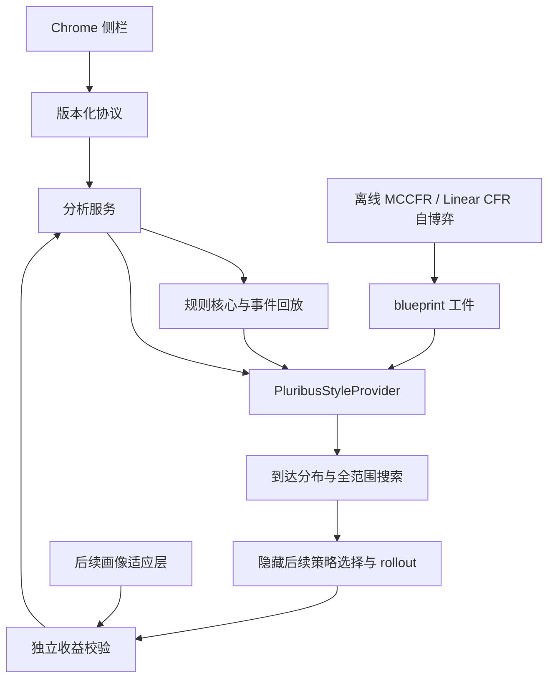

# 软件实现结构

状态：dev 分支的基础骨架。算法主线以 [Pluribus](pluribus-paper.md) 为依据，详细交付顺序见 [决策引擎](decision-engine.md)。

## 当前可运行边界

| 模块 | 已有内容 | 后续实现 |
| --- | --- | --- |
| apps/extension | 四个视图的空状态、服务状态检查、MV3 侧栏与构建入口 | 牌谱导入、纠错、回放、版本化分析展示 |
| packages/protocol | 健康响应运行时校验、JSON Schema 和共用样例 | 事件、状态、分析请求与响应契约 |
| packages/game-core | 玩家信息集、机会节点、合法动作和收益的 Python Protocol | Kuhn／Leduc、小型多人游戏、标准德州状态归约 |
| engines/strategy | 遗憾匹配基础函数、明确返回不支持的 provider | MCCFR／Linear CFR、blueprint、到达分布和多后续策略搜索 |
| services/analysis | 本机 GET /v1/health、精确 Origin 检查、接口测试 | 持久事件、任务预算、取消、模型注册与鉴权 |
| training | 作业与工件的开发说明 | 可恢复自博弈、独立对局评测和检查点 |

不提前建立空的 evaluator、opponent 或平台适配器实现；已有设计定义这些职责，进入对应阶段再添加代码。没有自动下注或页面采集入口。

## 核心依赖方向

该图表示目标依赖关系；当前只实现上表所列骨架。规则核心与策略引擎使用 Python 接口，便于共享模拟器与研究验证；性能瓶颈经测量后再替换为 C++／Rust。TypeScript 负责界面与传输契约，不另写一套相互漂移的扑克结算规则。

## 协议与持久化

当前健康响应的规范在 `packages/protocol/src/index.ts`，用 Zod 生成 JSON Schema。Python 响应模型由测试对照同一 Schema 与合成样例；`schema:check` 阻止生成物落后于源码。状态和分析协议在实现前扩展此目录，明确 schema 版本和未知字段处理。

后续事件持久化选 SQLite：原始事件追加写入，归约状态可重建；用 session/table/hand 标识隔离，并以 stateVersion 作废旧分析。画像统计只从有效事件和真实机会数归约；人工修正后重算，不能重复累加。当前没有创建数据库或存储真实玩家资料。

## 在线服务与扩展

当前 CLI 固定监听 loopback，健康接口只公开版本与能力；请求携带未知 Origin 时拒绝。浏览器预览与 Chrome 扩展分别加入精确允许列表，服务不允许通配 Origin。

新增牌谱、画像或分析 API 前，必须加入本地随机令牌、请求大小限制及版本化输入校验；远程部署还需 HTTPS、鉴权、租户隔离。当前健康骨架没有这些私有数据接口，不能直接当作远程生产服务部署。

侧栏请求超时为 5 秒；重试取消前一请求，旧结果不覆盖新结果，重试开始清空旧状态。该超时只用于健康检查，不代表论文搜索的预算。训练和搜索进入独立工作队列，禁止在 HTTP 请求线程中启动完整训练。扩展生产包仅使用本地脚本资源。

侧栏入口参考 Chrome 官方 [global side panel 示例](https://github.com/GoogleChrome/chrome-extensions-samples/blob/main/functional-samples/cookbook.sidepanel-global/service-worker.js) 的 `setPanelBehavior` 用法；浏览器目标保守设为 116+，与官方 [sidepanel-open 示例](https://github.com/GoogleChrome/chrome-extensions-samples/blob/main/functional-samples/cookbook.sidepanel-open/manifest.json) 的最低版本一致。本次构建校验不能代替真实 Chrome 的安装与交互验收。

## 算法构建顺序

1. 用 `ExtensiveGame` 实现可穷举小博弈，测试信息集不会泄露隐藏信息、合法动作和收益守恒。以独立精确计算校验 CFR。
2. 构建采样遍历、遗憾／平均策略更新和 Linear CFR；之后再测剪枝。现有 `regret_matching` 只完成正遗憾归一化这一环。
3. 加入 blueprint 工件的保存、恢复、规则／抽象版本和覆盖检查；检查点与牌谱默认不进 Git。
4. 构建策略诱导的根分布、hero 全范围搜索、对所有活跃玩家隐藏的后续策略选择和收益向量。
5. 与完整树、仅 blueprint 和不同截断方案比较。小型闭环通过后扩大到明确预算的六人德州，再分别做画像和蘑菇扩展。

完整参数以可核实论文资料为依据；缺少补充材料的部分显式记录工程选择和实验配置。基础骨架不提供伪造的策略频率、EV 或训练完成状态。

## 视觉设计的应用

根目录 DESIGN.md 保留指定参考原文。侧栏采用其深茄紫 `#4a154b`、奶油／淡紫表面、胶囊按钮和间距比例；针对窄侧栏使用较小字号。采用本地字体栈，不打包未授权的专有字体或加载远程字体。论文是算法依据，DESIGN.md 是视觉参考，两者职责明确。
