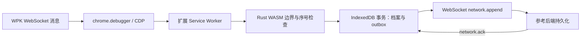

# TGTO-FronEnd 源码结构与接入核查

核查日期：2026-11-01（Asia/Shanghai）。用户指定仓库为 [Keria2026/TGTO-FronEnd](https://github.com/Keria2026/TGTO-FronEnd)，读取版本 `a2c6021ec7fb149812dfe5a7cc2167afa543305d`（包版本 0.2.0）。后端对照版本为 Texas-GTO `dev` 的 `0483bc2`。本次只读取前端源码并运行类型检查，未修改其运行代码，也未登录 WPK。

## 结论

这个仓库已有可以复用的网络采集和可靠传输实现，应作为生产采集扩展的接入基础。它目前传输的是网络元数据，未实现从 WPK 明文业务事件到牌局状态的适配，也没有算法结果接收／展示分支。现有 Texas-GTO 后端尚未支持其 WebSocket 契约；不能仅把端口改为 8765 就声称接通算法。

## 文件职责

| 路径 | 源码中的实际职责 |
| --- | --- |
| `extension/background.ts` | MV3 Service Worker，同步注册监听、串行处理捕获事件、初始化 WASM/IDB、管理采集与后端连接、处理恢复及侧栏命令 |
| `extension/capture.ts` | `chrome.debugger` 附着用户选择的 WPK 标签页，监听 CDP WebSocket 收发，递归处理允许的 iframe/Worker 目标 |
| `extension/core.ts` | 加载随包 WASM，验证 ABI 版本 2；以 u64/BigInt 调用序号、ACK、帧和容量检查 |
| `crates/capture-core/src/lib.rs` | 纯 Rust 校验函数；不包含 WPK 解码、完整业务 reducer、扑克求解或训练 |
| `extension/db.ts` | IndexedDB 的 sessions/events/outbox；严格事务分配序号、保存记录与待确认引用，ACK 不删除历史档案 |
| `extension/model.ts` | 网络元数据 schema、事件类型、u64 十进制序号和 20 位补零键 |
| `extension/transport.ts` | WebSocket 鉴权、能力协商、单批次在途、ACK 校验、心跳、退避重传 |
| `extension/sidepanel.tsx` | 采集开始／停止、连接、状态、最近元数据与本地导出；关闭侧栏不等于停止后台 |
| `tools/reference-backend.ts` | Node + SQLite 的本地协议参考接收器，持久提交后 ACK；无算法服务 |
| `scripts/build.mjs` | 生成实际 MV3 manifest、Chrome 125+、WASM CSP、后端地址限制和独立合成测试构建 |
| `docs/protocol.md`、`docs/wpk-adapter.md` | 未来业务契约和私有入口线索，不能当作已实现代码 |

## 当前实际数据流



采集来源限定 `https://h5.wpk.com/`，端点白名单是游戏 `wss://game.wpk111.com:11111/wepoker/game4/battle/echo` 和大厅 `wss://a92smtp.depucloud.cn:18002/`。这些是源码配置，本次没有验证真实网站当前端点仍然相同。

捕获 `Network.webSocketFrameSent`／`Received`，文本按 UTF-8、二进制按 base64 解码计长并计算 SHA-256。上传字段主要为连接 ID、去掉查询参数的端点、方向、opcode、长度、哈希和时间；其中没有手牌、公共牌、下注金额或赢家。哈希不能用于还原这些业务信息。

默认不保存原始载荷；显式开启时载荷只进入本地档案。`db.batch()` 只选 `record`，不会把本地 `payload` 发送给后端。该边界应继续保留，不能靠自动上传全部原始流替代业务适配。

开始附着立即记录 `attached_mid_stream` 缺口。未观察到创建事件的既有连接不纳入允许连接集；导航、debugger 脱离或 worker 恢复可能中断采集。恢复只补传已经落盘的记录，不补采期间丢失的消息。档案达到每会话 64 MiB 后停止，ACK 释放 outbox 不释放历史档案，因此暂不适用于无限期无人值守采集。

## 已实现的 WebSocket 契约

地址目前硬编码为两个本机端点：

- `ws://127.0.0.1:8765/v1/research/stream`
- `ws://127.0.0.1:8766/v1/research/stream`

握手顺序为：

```json
{"type":"auth","token":"EXAMPLE_RESEARCH_TOKEN"}
```

```json
{"type":"ready","schema_version":"1.2","capabilities":["network_events_v1"]}
```

然后使用 `schema: "tgto.network/0.1"` 的 `network.append` 批次与 `network.ack` 确认。每批最多 64 条／256 KiB；同一时刻只有一个批次在途。`source_id` 是采集 epoch，`sequence`／`through_sequence` 是十进制 u64 字符串，不能转换成不安全的 JS Number。

实际参考后端 ACK 当前提交批次最后一条序号；接收端按 source+sequence 校验重复内容并事务提交，客户端校验 ACK 不越过本次发送范围。接入时应保留这个窗口约定，不把后来更大的全局 head 回给旧重试批次造成超前 ACK。

每 20 秒 ping/pong；握手 5 秒、批次 ACK 10 秒超时；普通断线指数退避至最多 60 秒。鉴权或协议错误停止自动发送并保留数据。令牌在扩展 `chrome.storage.session` 的可信上下文中，浏览器完全重启后需重新输入。

注意三个独立版本：WebSocket 握手信封 `1.2`、网络记录 `tgto.network/0.1`、Texas-GTO 当前 HTTP 响应 `1.1`。后端新增 WS 能力应单独实现，不应直接将 HTTP health 版本改成 1.2 冒充兼容。

## 与算法服务之间的缺口

1. **业务明文适配**：前端文档提到 `HMFClient.sharedInstance()._dispatchMessageToCC` 与 `WPGameData.Instance`，但当前代码没有安装这些观察入口；`Runtime.runIfWaitingForDebugger` 只是恢复子目标执行，不是解码实现。需要可复现样本验证白名单字段、手牌异步解码时点和已确认行动语义。
2. **独立业务事件流**：`capture_events_v1`、`tgto.capture/0.1`、`capture.append`／`capture.ack` 目前只在草案里。网络序号、业务序号和快照序号不能混用，上传网络元数据不能确认业务事件已经上传。
3. **后端接收端**：核对 Texas-GTO 的实际 FastAPI 路由，既没有 `/v1/research/stream`，也没有草案引用的 `/v1/observations`。本地 HTTP bearer middleware 也不是 WebSocket 首消息鉴权实现。需要独立加入 Origin、认证、能力协商、连续落盘与持久 ACK。
4. **算法结果返回**：当前 `transport.ts` 只识别 ready/pong/network.ack/error，其他消息会触发协议错误并停止连接。必须增加明确协商的分析请求／响应类型及侧栏状态版本守卫，服务端不能直接推送未定义的 recommendation。
5. **服务器部署**：运行时 BACKENDS、生成的 manifest 权限及 CSP 都仍限制 loopback。公网接入需要一致地配置实际 WSS 域名、精确扩展 Origin 与生产账户权限；参考接收器不是多用户算法服务器。
6. **目标规则**：后端仍需八人、强制 straddle、动态筹码和蘑菇会话规则及对应策略。正确采集不会自动使当前稀疏六人模型适用于新目标桌。

## 项目接入安排

- `TGTO-FronEnd` 作为 Chrome 采集、WASM 轻量检查、耐久队列、通信和正式侧栏的前端实现基础。
- `Texas-GTO` 负责服务器接入、权威牌局状态、画像、蘑菇账本、Pluribus 主线训练／搜索及独立评测。现有 `apps/extension` 保留为算法研究工作台，避免再从零平行建设一套正式采集器。
- 保留现有网络元数据能力作接入与完整性诊断；新增业务能力时分别标明两种 ACK 和覆盖状态。业务字段成熟前不声称已接入实时决策。
- 对齐契约和合成集成样例，再实现业务适配及算法结果协议，最后迁移 WSS。前端断线／gap、换手或状态变化立即使旧建议失效。

## 本次验证边界

已逐文件核查上述实现，`npm ci --ignore-scripts` 和 `npm run typecheck` 通过，前端工作树无源码修改。直接读取当前 FastAPI 路由确认上述两个端点不存在。

当前执行环境没有 `cargo`，本次未重新执行 Rust/WASM 构建、依赖真实 WASM 的 Node 测试或 Chromium 集成测试。前端仓库 `docs/validation.md` 记录的 6 项 Rust／15 项 Node／2 项浏览器通过属于该仓库既有记录，不能当作本次重新验证结果。未使用真实账号或确认实时 WPK 协议。
